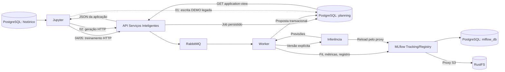

# Marista — Horários Inteligentes

Esta POC demonstra a arquitetura de IA para uma **proposta de Planilha Turmas**:
SQL → treino real → MLflow/Registry → RustFS → inferência de versão explícita →
PostgreSQL de negócio → contrato HTTP da aplicação. Jupyter é a bancada do
cientista; a geração operacional V2 pertence à API e ao worker.

**Dados sintéticos, regras DEMO e contrato provisório.** Não publica no PRIME,
não matricula estudantes, não aloca docentes/horários/salas e não homologa a V4.4.
Capacidade40 é ilustrativa. Quantidades por categoria desconhecidas continuam
`null` e regras institucionais sem evidência ficam `NOT_EVALUATED`.

## 1. Prova da arquitetura C2/C3

| Componente local | Responsabilidade | Correspondência futura |
|---|---|---|
| JupyterLab | Explorar, experimentar, submeter jobs e testar APIs | Workbench |
| MLflow | Tracking, Registry e proxy de artefatos | Serviço de MLOps do ambiente |
| RustFS/S3 | Snapshots, modelos e manifests | Object Storage |
| PostgreSQL | Metadados e negócio em bancos separados | Cloud SQL/PostgreSQL |
| API, Celery, RabbitMQ, inferência | Orquestração e serving separados do treino | Serviços/containers V3 |
| Docker Compose | Runtime executável desta POC | Implantação futura em Kubernetes |

A correspondência é funcional; não comprova equivalência de HA, custo, rede ou
capacidade em GCP. [Fontes V3/V4.4](artifacts/reports/correcoes-fase-a-2026-11-04.md),
[cobertura funcional](docs/architecture/FUNCTIONAL_COVERAGE.md) e
[decisões V2](docs/adr/010-durable-operations-v2.md).



**01** preserva a jornada didática com treino/persistência no notebook.
**02 V2** escreve exclusivamente por HTTP: API→worker→inferência→composição→banco.
**04/05** submete treino ao worker, independente do kernel. Os bancos
`planejamento_db` e `mlflow_db` usam uma única instância PostgreSQL.

## 2. Serviços e acessos

| Serviço | Navegador/host | DNS interno | Responsabilidade, persistência e autenticação |
|---|---|---|---|
| Jupyter | [localhost:8888](http://localhost:8888) | jupyter:8888 | Bancada; bind mount workspace; JUPYTER_TOKEN |
| MLflow | [localhost:5000](http://localhost:5000) | mlflow:5000 | Tracking/Registry em mlflow_db; proxy; acesso host restrito a loopback |
| RustFS console | [localhost:9001](http://localhost:9001) | rustfs:9001 | Login pelas chaves S3 do .env |
| RustFS S3 | localhost:9000 | rustfs:9000 | Bucket pucpr-poc; volume rustfs; assinatura S3 |
| API/Swagger | [localhost:8000/docs](http://localhost:8000/docs) | api:8000 | Propostas/campanhas/governança; API_TOKEN; OPERATOR_TOKEN separado para revisão |
| Inferência | localhost:8001 | inference:8001 | Versão/hash explícitos; cache até4 modelos por processo; INFERENCE_TOKEN |
| Ingestion | [localhost:8020/docs](http://localhost:8020/docs) | ingestion:8020 | Snapshot; INGESTION_TOKEN |
| Dashboard | [localhost:8088](http://localhost:8088) | dashboard:8088 | Saúde/eventos JSONL; DASHBOARD_TOKEN |
| Monitoramento | localhost:8010 | monitoramento:8010 | Métricas operacionais; MONITOR_TOKEN |
| RabbitMQ | [localhost:15672](http://localhost:15672) | rabbitmq:5672 | Transporte durável; usuário poc/RABBITMQ_PASSWORD; volume rabbitmq |
| Worker | Sem interface própria | worker | Dois processos; treino/composição; checkpoint no PostgreSQL |
| PostgreSQL | Sem porta publicada | postgres:5432 | Volume postgres; usuários de aplicação, leitura, migration e MLflow |

`mlflow:5000` só resolve entre containers. Navegador e traces usam localhost5000;
tracking continua interno. Links automáticos internos do SDK foram desativados.

### Acessar o RustFS e conferir os modelos

Console9001: usuário/chave `AWS_ACCESS_KEY_ID` e senha `AWS_SECRET_ACCESS_KEY`
do `.env` local. Os nomes AWS correspondem ao protocolo S3, sem exigir conta AWS.
No bucket `pucpr-poc`, modelos estão em `mlflow/`, snapshots em `snapshots/` e
manifests em `lineage/poc/planilha-turmas/`. Cada relatório mostra chave exata e
SHA256, comparados com download pelo proxy. Porta9000 é API,9001 é console.

## 3. Instalação e operação

Requer Docker Desktop/Linux containers ou Docker Engine/Compose v2, Git e
Python3.11+ para scripts administrativos. Serviços rodam somente nos containers.
Execute na raiz. Primeira instalação Windows:

```powershell
.\deployment\scripts\compose.ps1 init
```

Cria `.env`, imagens, bancos, migrations, bucket e seed; aguarda readiness e testa.
Não copie segredos para células, Git ou documentação. Linux:

```bash
python deployment/scripts/init_env.py
sh deployment/scripts/journey.sh rebuild
```

Instalação existente Windows:

```powershell
.\deployment\scripts\compose.ps1 start
.\deployment\scripts\compose.ps1 status
.\deployment\scripts\compose.ps1 stop
.\deployment\scripts\compose.ps1 rebuild
```

`start` usa imagens atuais. `rebuild` aplica código/migrations preservando volumes
e dados e executa uma nova jornada DEMO identificada; não faz reset.
Linux: `docker compose up -d --wait`, `docker compose ps`, `docker compose stop`;
rebuild pelo script. Bootstrap acrescenta OPERATOR_TOKEN ausente sem trocar
credenciais existentes. Configuração: [.env.example](.env.example),
[Compose](compose.yaml), [gerador](deployment/scripts/generate_compose.py).

Fonte SQL sintética: `planejamento_db.planning`. Notebook lê com usuário readonly;
worker usa usuário de aplicação. [Consulta versionada](sql/queries/journey_history.sql)
recebe snapshot, ciclo e curso. Sem fallback automático para DEMO ou SQLite.

## 4. Demonstração em 18 passos

1. Suba o ambiente e confira os serviços com `status`.
2. Abra Jupyter8888 com o token local.
3. Execute **00** em kernel novo: SQL, tracking real, artefato diagnóstico e versões.
4. Execute **03**: SQL, snapshot, esquema, amostra, nulos, distribuição e hashes.
5. Confira a ordem temporal treino/avaliação/inferência e ausência de vazamento.
6. No **04**, escolha snapshot, modelo `hi.demo.<nome>`, algoritmo e alpha.
7. Configure `execute_write=True`, `confirmation="EXECUTE_DEMO"` e `request_key` estável.
8. Execute04: worker treina, compara baseline, registra versão, recarrega e verifica bytes.
9. Abra a run no MLflow pelo link; confira parâmetros, métricas e artefatos.
10. Abra RustFS e encontre a chave/checksum mostrados no relatório.
11. Alternativamente execute **01_jornada_completa_planilha_turmas.ipynb** para o fluxo legado completo.
12. No **02**, escolha `GENERATE_AND_VALIDATE`, snapshot, nome/versão, capacidade e chave.
13. Confirme a escrita; acompanhe POST202, job_id e correlation_id até COMPLETED.
14. Veja o JSON integral application-view, hash, paginação e origens por linha.
15. Confira reconciliação independente: mesmos registros SQL e artefatos MLflow/RustFS.
16. Repita02 com mesma chave/payload: mesmo job/proposta. READ_EXISTING apenas consulta.
17. Abra **08** com proposal_id e navegue por run, versão, snapshot e campanha.
18. Consulte dashboard por correlation_id e relatórios JSON/Markdown em artifacts/reports/v2.

[Parâmetros e exemplos executáveis](docs/operations/OPERATIONS_V2.md).
Use **Restart Kernel and Run All**. Há uma entrada por notebook. Reiniciar a mesma
versão preserva edições; atualização arquiva a cópia anterior em
`workspace/notebook-backups/` antes de instalar a nova fonte. Markdown volta a ser
renderizado com **Shift+Enter** ou **Ctrl+Enter**.

## 5. Campanhas e 500 modelos

**05** cria, consulta, pausa, retoma, cancela e reprocessa campanhas. PostgreSQL
guarda estado/checkpoints/eventos; RabbitMQ transporta. Fechar Jupyter não cancela.
Até2 processos; cancelamento cooperativo preserva resultados já concluídos.

Um MLflow por ambiente, experimento por domínio, run por tentativa e versões por
nome estável. Identidades `hi.demo.*` são sintéticas; nomes legados são preservados.
O ensaio V2 executou500 treinos reais no mesmo snapshot agregado, em stack isolada.
Isso não equivale a500 fontes/cursos reais,500 APIs ou500 modelos carregados ao mesmo
tempo. [Organização, testes e limites](docs/operations/MLFLOW_MODEL_ORGANIZATION.md).

## 6. Governança, lineage e reset

**06** compara runs do mesmo snapshot/janela e elege candidato. **07** solicita
revisão, verifica bytes e recebe decisão com operador autenticado, versão e motivo.
Modo APPROVED exige aprovação SQL concordante com alias champion. DEMO explícito
não aprova automaticamente. Revogação e rollback são auditados; rollback requer
versão antes aprovada. Isso não aprova/publica uma matriz acadêmica.

**08** mostra relações e checks VERIFIED/LEGACY_PARTIAL/MISSING/MISMATCH. Legado
sem hash permanece incompleto. Jobs têm trace_id/correlation_id e eventos no
dashboard. [Lineage](docs/architecture/LINEAGE.md) · [Tracing](docs/operations/EXPERIMENTS_AND_TRACING.md).

**09 nunca apaga com Run All.** Prepara parâmetros, inventário e auditoria. O
controlador externo exige escopo validado, plano recente e frase forte. `empty`
recria schema/serviços; `demo-ready` acrescenta seed sem treinar. Backups existentes
são protegidos. Não se executa reset principal durante estes testes.
[Reset e recuperação](docs/operations/RESET_POC.md).

## 7. Contrato da aplicação

**poc-planilha-turmas-v1 — PROVISÓRIO / PENDENTE DE HOMOLOGAÇÃO.** Oferta abreviada
ilustrativa; envelope completo inclui IDs, lineage, paginação, hash e validações:

```json
{
  "status": "SUGERIDA",
  "forecast_raw": 82.3,
  "students": {"regular": null, "dependency": null, "elective": null, "total": 83, "origins": null},
  "modulation": {"rule_version": "POC-whole-cohort-ceil-capacity-v1", "capacity": 40, "proposed_groups": 3, "groups": null, "provisional": true},
  "teacher_suggestion": null,
  "human_adjustment": null,
  "source_model_keys": ["hi.demo.exemplo"]
}
```

[Swagger](http://localhost:8000/docs) · [Schema](docs/contracts/README.md)
· [Notebook02](docs/operations/INFERENCE_NOTEBOOK.md). Regras retornam
PASS/FAIL/NOT_EVALUATED. Mesma chave/payload não duplica; nova chave cria outra
proposta DRAFT sem sobrescrever original ou revisões humanas.

## 8. Persistência

| Informação | Destino |
|---|---|
| SQL sintético, propostas/linhas | planejamento_db.planning |
| Jobs/campanhas/checkpoints/revisão/auditoria | Mesmo schema planning, migrations006/007 |
| Grafo e N:N proposta↔modelo | planning.lineage_* e proposal_model_usage |
| Experimentos/runs/métricas/Registry/traces | mlflow_db; schema administrado pelo MLflow |
| Binários/manifests | RustFS/pucpr-poc; volume rustfs |
| Mensagens | RabbitMQ; volume rabbitmq; estado confiável permanece no PostgreSQL |
| Notebooks/cópias anteriores | workspace/notebooks e workspace/notebook-backups |
| Relatórios/logs | artifacts/reports e data/compose-logs |

Sem migrations próprias das tabelas MLflow. Bootstrap usa SDK suportado e
`mlflow db upgrade` antes de liberar servidor. [Versões fixadas](config/requirements.lock).

## 9. Evidências e diagnóstico

[Relatórios V2](artifacts/reports/v2/) registram execução, IDs, hashes e limitações.
[Aceite V1.1 histórico](artifacts/reports/correcoes-v1.1-acceptance.md) não substitui
aceite V2. PASS exige execução real; PARTIAL/NOT_EXECUTED não são conclusão.

```powershell
.\deployment\scripts\compose.ps1 journey
.\deployment\scripts\compose.ps1 test
python deployment/scripts/validate_static.py
python deployment/scripts/generate_compose.py --check
docker compose logs --tail 100 api worker inference mlflow
```

| Sintoma | Verificação |
|---|---|
| mlflow não resolve no navegador | Abra localhost:5000; preserve tracking interno |
| Notebook readonly | Abra workspace pelo Jupyter8888; confira permissão do bind mount |
| Markdown aparece como texto | Shift+Enter |
| 401/403 | Token apropriado; revisão usa OPERATOR_TOKEN separado |
| 409 ao repetir | Não reutilize chave para outro payload |
| Job parado após reinício | Aguarde recuperação60s; consulte worker, broker e eventos |
| Campanha FAILED | Restaure dependência; use retry-failed com mesmo campaign_id |
| Hash/alias divergente | Falha fechada; investigue a referência exata |
| Plano de reset expirado | Gere novo preview; não altere plano para forçar execução |

[Catálogo](notebooks/README.md) · [Jupyter](docs/operations/JUPYTER.md)
· [ADRs](docs/adr/README.md) · [Histórico](history/state.md).
