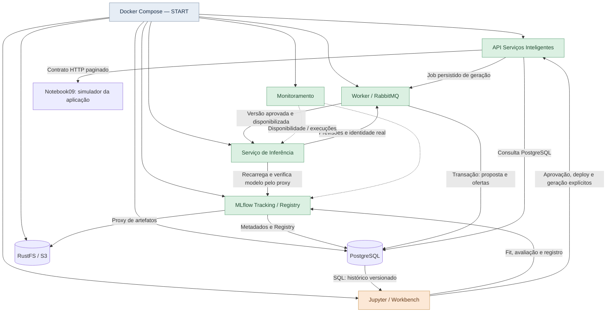

# Marista — Horários Inteligentes

POC de previsão de demanda e geração de **propostas de Planilha Turmas**. A jornada
principal é **00 → 01 → 02 → 03 → 04/05 → 06 → 07 → 08 → 09 → 10** no Jupyter.
O treinamento executa no Workbench; os serviços operacionais permanecem disponíveis
sem notebook aberto. [Roteiro V4](docs/operations/POC_V4_MANUAL_RUNBOOK.md).

**Dados demonstrativos:** 107 linhas de planejamento de2024.2 fornecem a estrutura
de70 ofertas. Um histórico sintético reproduzível alimenta três modelos por curso
(2248,2348,2287). Planejamento, matrícula sintética e previsão têm origens distintas.
Não há integração PRIME, matrícula oficial, capacidade homologada ou aprovação acadêmica.

## Arquitetura C3



| Componente | Responsabilidade |
|---|---|
| Jupyter | Importação SQL, exploração, fit/predict de avaliação, campanhas locais e métricas |
| MLflow3.11.1 | Tracking, Registry, assinatura, versões explícitas e proxy de artefatos |
| PostgreSQL15 | Bancos lógicos de MLflow/aplicação, checkpoints e propostas |
| RustFS | Binários MLflow, manifests e artefatos em volume persistente |
| API | Autenticação, revisão técnica, deploy, jobs e consulta da aplicação |
| Worker / RabbitMQ | Jobs recuperáveis, inferência e persistência; sem treinamento |
| Inferência | PRELOAD seletivo, LAZY e cache de até4 versões V4 por processo |
| Monitoramento / dashboard | Saúde e eventos correlacionados por execução |
| Ingestion | Adaptador legado; a jornada V4 importa referências no Workbench |

Registro não implica aprovação ou carregamento. A sequência técnica é
`TRAINED → VALIDATED → APPROVED → DEPLOYED → LOADED`. Cada inferência confere
aprovação SQL e alias `champion`, inclusive com cache aquecido. Revogação bloqueia
novas chamadas. PRELOAD carrega no startup; LAZY quando solicitado. Os serviços
iniciam sem treinar e sem exigir que já existam modelos. A correspondência C3 é
funcional; não comprova capacidade, HA ou custos em GCP.

## Subir e reconstruir

Pré-requisitos: Git, Python3.11/3.12 para scripts administrativos e Docker Desktop
com containers Linux. Reserve inicialmente8GiB para Docker; Jupyter tem limite
de3GiB e concorrência de treino1..2. Isto é configuração da POC, não dimensionamento
para500 modelos simultâneos. Serviços não executam no host.

Na raiz do repositório, PowerShell:

```powershell
# Primeira instalação: imagens, bancos, migrations e serviços.
.\deployment\scripts\compose.ps1 init
# Uso diário:
.\deployment\scripts\compose.ps1 start
# Atualizar código preservando volumes, dados e notebooks:
.\deployment\scripts\compose.ps1 rebuild
.\deployment\scripts\compose.ps1 status
```

Linux: `sh deployment/scripts/journey.sh rebuild` ou `docker compose up -d --wait`.
O inicializador gera o `.env` local; [.env.example](.env.example) documenta as variáveis
sem segredos. Preserve o `.env` de uma instalação com dados. Reset é uma operação
separada e confirmada pelo controlador externo.

Coloque as três planilhas originais em `data/reference/`. O Compose monta essa pasta
como `/reference:ro` no Jupyter; macros não são executadas. `dev/` e `history/`
permanecem locais e ignorados pelo Git. O histórico de trabalho continua atualizado.

## Acessos

| Interface | Navegador | Autenticação |
|---|---|---|
| JupyterLab | [localhost:8888](http://localhost:8888/lab/tree/notebooks/00_ambiente.ipynb) | JUPYTER_TOKEN |
| MLflow | [localhost:5000](http://localhost:5000) | POC restrita ao loopback |
| RustFS console | [localhost:9001](http://localhost:9001) | AWS_ACCESS_KEY_ID / AWS_SECRET_ACCESS_KEY |
| RustFS S3 | localhost:9000 | Credenciais S3; endpoint de API |
| API / OpenAPI | [localhost:8000/docs](http://localhost:8000/docs) | API_TOKEN; revisões/deploy exigem OPERATOR_TOKEN |
| Dashboard | [localhost:8088](http://localhost:8088) | DASHBOARD_TOKEN |
| RabbitMQ | [localhost:15672](http://localhost:15672) | Usuário poc; RABBITMQ_PASSWORD |

As credenciais estão no `.env`, nunca nos notebooks. Entre containers:
`http://mlflow:5000`, `http://api:8000`, `http://inference:8001`, `http://rustfs:9000`.
Esses DNS são internos; links do navegador usam MLFLOW_UI_BASE_URL=localhost:5000.

## Executar pelo Jupyter

Abra `notebooks/00_ambiente.ipynb` na pasta editável. Em cada notebook, use
**Kernel → Restart Kernel and Run All**. `Shift+Enter` renderiza Markdown; duplo clique
edita; `Ctrl+S` salva. Reinícios preservam edições. Atualizações arquivam cópias
anteriores em `workspace/notebook-backups/`.

| Notebook | Resultado |
|---|---|
| 00 ambiente | SQL, servidor/SDK MLflow e gravação/leitura real de artefato |
| 01 fontes | Importação idempotente,107 origens, hashes e dicionário |
| 02 qualidade |70 ofertas, quarentena, P164/P110A e chaves acadêmicas |
| 03 exploração | Snapshot sintético seed42 por coorte/ciclo/disciplina |
| 04 individual / 05 lotes | Fit no Jupyter, métricas selecionáveis, runs e versões |
| 06 avaliação | Baseline, métricas por target e populações comparáveis |
| 07 governança | Revisão explícita com operador; padrão somente inspeção |
| 08 publicação | Deploy e geração pela API, mediante controles explícitos |
| 09 simulador | Tabela exclusivamente HTTP, filtros e detalhe das atividades |
| 10 auditoria | Confronto SQL/HTTP/Registry/RustFS antes de declarar VERIFIED |
| 11 reset | Inspeção e orientação; não executa exclusão |

Em07, revise as candidatas, ajuste `APPROVE_DEMO=True` e execute a célula de decisão.
Em08, ajuste `DEPLOY_DEMO=True` e `GENERATE=True` após aprovação. A geração completa
usa os três cursos do05. O contexto salvo leva proposal_id automaticamente ao09;
há override explícito. Nunca se escolhe uma versão por latest.

**Repetição:** mesma chave e payload recuperam campanha/job sem duplicação.
Payload diferente com a mesma chave é recusado. Uma chave nova representa outra
execução intencional; a proposta anterior permanece imutável. Aprovação técnica
do modelo não é aprovação acadêmica da proposta.

## Dados e modelo

O Jupyter abre SOURCE_DATABASE_URL e consulta planning.model_training_observations
do snapshot escolhido. O histórico é separado do conjunto futuro; a avaliação usa
o último ciclo histórico. Transformações são ajustadas somente no treino.
Features: semestre, período e defasagens das categorias. O estimador de regulares
não recebe adicionais de disciplinas como features. Ridge é comparado com baseline;
histórico insuficiente usa DummyRegressor com motivo. Métricas sintéticas não
medem qualidade institucional.

P164 preserva41 planejados na teoria e21+20 nas práticas; não são82 alunos.
Atividades são filhas da oferta. Capacidade oficial ausente permanece nula e
grupos propostos ficam pendentes. Unificações não são efetivadas. O arquivo V3
contém31 entidades/175 campos, divergindo das30 citadas na especificação.

| Dado | Persistência |
|---|---|
| Experimentos, runs, métricas, traces e Registry | PostgreSQL mlflow_db, schema gerenciado pelo MLflow |
| Referências e simulação | planejamento_db.planning.academic_* e model_training_observations |
| Campanhas científicas | planning.workbench_campaigns e workbench_models |
| Aprovação e serving | planning.model_approval_requests e academic_deployments |
| Proposta de negócio | planning.ai_proposals_v2 e ai_proposal_offers_v2 |
| Modelos e manifests | RustFS bucket pucpr-poc; binários somente no prefixo MLflow |

APPLICATION_DATABASE_URL aponta ao banco de negócio. O worker insere proposta e
ofertas em transação; a API só publica após conclusão e manifesto.
`GET /v2/proposals/{id}/application-view` consulta PostgreSQL com filtros,
paginação e hash. [Contrato V2](docs/contracts/academic_application_v2.md).

## Evidências e limites

[artifacts/reports/v4](artifacts/reports/v4) contém treino com worker parado,
checksums, idempotência, revogação com cache aquecido, restart sem Jupyter e
execução dos12 notebooks em kernels novos. Inspeção visual manual permanece
MANUAL_NOT_CHECKED; CI remota requer execução identificada, não é presumida.

Diagnóstico: `docker compose logs --tail 100 api inference worker mlflow`.
O MLflow inicializa seu próprio schema; migrations da aplicação são aditivas.
Não há SQLite nem fallback silencioso de tracking. Os notebooks anteriores ficam
em `notebooks/legacy/`; o endpoint de treinamento operacional legado retorna410.
