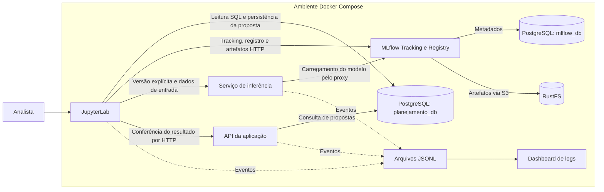

# Marista — Horários Inteligentes

**RustFS:** [abrir console](http://localhost:9001) · [usuário, senha e localização dos modelos](#acessar-o-rustfs-e-conferir-os-modelos).

**Correções v1.1:** [relatório de execução e critérios de aceite](artifacts/reports/correcoes-v1.1-acceptance.md).
Inclui testes reais, persistência, rastreabilidade, contrato da API e limitações.

Prova de conceito de uma plataforma de IA para apoiar o planejamento acadêmico.
O projeto demonstra a geração de uma **proposta de Planilha Turmas**, desde a
leitura do histórico até a consulta do resultado pela API, mantendo a ligação
entre dataset, treinamento, versão do modelo e proposta gerada.

A jornada principal é executada pelo Jupyter e integra PostgreSQL, MLflow,
armazenamento de objetos e serviços FastAPI. O ambiente usa Docker Compose e
inclui processamento assíncrono, monitoramento e um dashboard de logs.

**O cenário demonstrado usa dados sintéticos.** O modelo prevê demanda de
estudantes; uma regra de composição transforma a previsão em quantidades
propostas de estudantes e turmas. A POC ainda não resolve a alocação de horários,
salas e professores nem representa integração com fontes institucionais.

## Arquitetura

Referências institucionais: desenhos de componentes, containers e sequência V3;
requisitos V4.4 de 25/09/2026. [Fontes e diagnóstico](artifacts/reports/correcoes-fase-a-2026-11-04.md)
e [matriz de responsabilidades/cobertura](docs/architecture/FUNCTIONAL_COVERAGE.md).
Jupyter é análogo funcional ao Workbench, RustFS ao Object Storage e PostgreSQL ao
armazenamento relacional. Na arquitetura-alvo, o worker da aplicação coordena e
persiste o negócio; a escrita DRAFT pelo notebook é um adaptador demonstrativo.
Não há publicação institucional ou aprovação automática.

### Navegação da evolução v1.1

- [Catálogo dos dez notebooks e permissões](notebooks/README.md).
- [Identidades, hashes e navegação HI-LINEAGE](docs/architecture/LINEAGE.md).
- [Contrato JSON provisório da aplicação](docs/contracts/README.md).
- [Notebook02: validar a proposta existente](docs/operations/INFERENCE_NOTEBOOK.md).
- [Organização de30/500 modelos e limites medidos](docs/operations/MLFLOW_MODEL_ORGANIZATION.md).
- [Reset total e confirmação forte](docs/operations/RESET_POC.md).

O contrato `poc-planilha-turmas-v1` é **PROVISÓRIO / PENDENTE DE HOMOLOGAÇÃO**.
No notebook02, ausência de dados de coorte, turno, origem de estudantes ou matriz
institucional aparece como null/NOT_EVALUATED. Capacidade40 é regra DEMO, não
comprovação de RF040–047.

O Jupyter é o ambiente de trabalho do analista: abre as conexões SQL, prepara os
dados e treina o modelo. O MLflow é um serviço independente: recebe parâmetros,
métricas e artefatos, mantém o catálogo de versões e grava os binários no RustFS.
A API consulta as propostas persistidas no PostgreSQL.



Os dois bancos do diagrama pertencem à **mesma instância PostgreSQL**. A separação
é lógica: o MLflow administra seu schema; a aplicação administra o schema
`planning` por migrations Alembic.

O ambiente também possui uma API de entrada de datasets (`ingestion`),
RabbitMQ/Celery para previsões em lote e um serviço de monitoramento. Esses
componentes atendem ao fluxo de treinamento e publicação por série acadêmica.
A jornada principal usa inferência síncrona com uma versão registrada
explicitamente e gera uma proposta no estado `DRAFT`.

### Componentes

| Serviço Compose | Tecnologia | Responsabilidade |
|---|---|---|
| `jupyter` | JupyterLab 4.3.5, Python 3.12.9 | Executar notebooks, leitura SQL, preparação, treinamento e composição da proposta |
| `mlflow` | MLflow 3.11.1 | Tracking, Model Registry e proxy de artefatos; servidor e SDK na mesma versão |
| `postgres` | PostgreSQL 15.10 | Guardar dados acadêmicos, propostas, auditoria e metadados MLflow em bancos separados |
| `rustfs` | RustFS 1.0.0, API S3 | Persistir modelos, artefatos, snapshots Parquet e backups lógicos |
| `api` | FastAPI | Consultar propostas e rastreabilidade; receber solicitações de previsão |
| `inference` | FastAPI, scikit-learn | Carregar a versão selecionada e prever; rotear pedidos do fluxo de modelos publicados |
| `ingestion` | FastAPI | Validar datasets agregados e persistir snapshots e estado de treinamento |
| `rabbitmq` | RabbitMQ 4.0.5 | Transportar tarefas assíncronas entre API e workers |
| `worker` | Celery 5.4.0 | Processar previsões em lote e persistir resultados e estado dos jobs |
| `monitoramento` | FastAPI | Consultar qualidade, execuções e deployments periodicamente |
| `dashboard` | HTML, CSS, JavaScript e FastAPI | Apresentar conexões, jobs, modelos e eventos filtrados por correlação |

São onze serviços contínuos. Os utilitários `tools` e `volume-tools` executam
tarefas pontuais de bootstrap, migrations, seed, testes e preparação de volumes.
A publicação de modelos aprovados pode acrescentar uma API dedicada por modelo.

Os dois [Dockerfiles](deployment/docker) constroem `marista-app:compose`,
compartilhada pelos serviços Python, e `marista-jupyter:compose`, com ambiente e
kernel próprios. Dependências diretas estão em [pyproject.toml](pyproject.toml),
e o conjunto fixado usado no build está em
[config/requirements.lock](config/requirements.lock).

## Como rodar

### Pré-requisitos

- Docker Desktop com containers Linux e Docker Compose v2.
- Git para clonar e atualizar o repositório.
- PowerShell no Windows.
- Python 3.11 ou superior no host para validadores e scripts auxiliares.
  Treinamento, APIs, bancos e testes da aplicação executam nos containers.
- Acesso à internet no primeiro build para baixar imagens e dependências.

Os comandos abaixo usam o contexto `desktop-linux`. O script respeita
`DOCKER_CONTEXT` quando outro contexto Docker é definido. As portas listadas em
[Interfaces e acesso](#interfaces-e-acesso) precisam estar disponíveis.

### Primeira instalação — Windows

```powershell
git clone --branch development https://github.com/Quanticoi/marista-horas-intel-poc-ia.git
cd marista-horas-intel-poc-ia

$env:DOCKER_CONTEXT = "desktop-linux"
docker info
docker compose version
python --version

.\deployment\scripts\compose.ps1 init
```

Se o PowerShell bloquear o script pela política de execução, libere apenas a
sessão atual e repita o comando:

```powershell
Set-ExecutionPolicy -Scope Process Bypass
.\deployment\scripts\compose.ps1 init
```

O `init` gera um `.env` com credenciais aleatórias quando o arquivo ainda não
existe, constrói as imagens e prepara diretórios e volumes. Depois inicia as
dependências, cria bancos e papéis, aplica migrations, configura o bucket e
carrega o dataset sintético. Por fim, aguarda a saúde dos serviços, executa o
notebook principal em kernel novo e roda os testes e checks de acesso.

O schema do MLflow é atualizado pelo próprio `mlflow db upgrade` antes de o
servidor abrir sua porta. O script encerra com erro se uma etapa obrigatória falhar.

### Subir e atualizar uma instalação existente

```powershell
.\deployment\scripts\compose.ps1 start
.\deployment\scripts\compose.ps1 status
```

O resultado esperado é a lista de serviços em execução e com saúde `healthy`.
Para aplicar alterações de código ou dependências:

```powershell
.\deployment\scripts\compose.ps1 rebuild
```

O rebuild constrói as imagens, reaplica bootstrap e migrations, garante o seed,
recria os serviços necessários e executa a jornada e seus testes. Volumes e
cópias de trabalho dos notebooks são preservados. Mantenha o `.env` original
quando reutilizar bancos e volumes existentes.

Para Docker Engine no Linux, siga o [guia de instalação Linux](docs/installation/LINUX.md).
Com o ambiente provisionado, `sh deployment/scripts/journey.sh journey` executa
a jornada; `rebuild` e `acceptance` também estão disponíveis nesse script.

## Executar pelo Jupyter

1. Abra [JupyterLab](http://127.0.0.1:8888/lab) e autentique com o valor de
   `JUPYTER_TOKEN` do `.env` local.
2. Abra [notebooks/01_jornada_completa_planilha_turmas.ipynb](http://127.0.0.1:8888/lab/tree/notebooks/01_jornada_completa_planilha_turmas.ipynb).
3. Selecione o kernel **PUCPR Python 3.12**.
4. Execute **Restart Kernel and Run All**.
5. Confira as tabelas de status, a proposta retornada pela API e os links da run
   exibidos no resumo final.

O notebook é dividido em etapas com objetivo, código executável e evidência.
A implementação fica em módulos Python reutilizáveis de `src/`.

| Etapa | O que acontece | Evidência exibida |
|---|---|---|
| 1. Dependências | Verifica SQL de origem/destino, versão do MLflow, tracking e upload/download de diagnóstico | Tabela PASS/FAIL; bloqueio antes do treino em caso de falha |
| 2. Extração SQL | Executa consulta parametrizada por snapshot, ciclo e curso | SQL, contagem, tipos, amostra, filtros e hash |
| 3. Preparação | Separa treino, avaliação e entrada futura por ordem temporal | Quantidades e intervalos de cada conjunto |
| 4. Modelo e métricas | Instancia pipeline Ridge e define MAE/RMSE | Features, alvo, semente e estimador |
| 5–6. Tracking e treino | Cria run, registra referências, executa fit/predict e avalia | Run, experimento, parâmetros, métricas e link MLflow |
| 7. Registro | Persiste pipeline, assinatura e exemplo; registra versão | Nome, versão e URI do modelo |
| 8. Inferência | Recarrega a versão persistida e chama o serviço de inferência | Versão carregada, quantidade e comparação das previsões |
| 9–10. Proposta | Compõe estudantes/turmas e grava cabeçalho, linhas e auditoria em transação | Proposta DRAFT e repetição idempotente |
| 11–12. Consulta e resumo | Consulta a API e reconcilia registros e quantidades | Linhas persistidas, rastreabilidade, status e links |

### Onde editar os notebooks

| Local | Uso |
|---|---|
| `notebooks/` no repositório | Fontes versionadas distribuídas com o projeto |
| `notebooks/` dentro do Jupyter | Cópias editáveis, salvas no host em `workspace/notebooks/` |

A inicialização disponibiliza o catálogo00–09 no workspace e preserva arquivos
editados. Atualizações conflitantes recebem sufixo `.update-<hash>`; compare essa
cópia com sua edição antes de incorporá-la. Para versionar alterações
feitas no Jupyter, revise e copie o arquivo de volta para `notebooks/` do repositório.

Para executar automaticamente:

```powershell
.\deployment\scripts\compose.ps1 journey
```

Esse comando usa o notebook empacotado na imagem, inicia um kernel novo e salva
`artifacts/reports/01_jornada_completa_planilha_turmas.executed.ipynb`. Depois de
alterar módulos ou o notebook versionado, use `rebuild` para atualizar a imagem
antes da execução automatizada.

## Dados, modelo e proposta gerada

O [gerador sintético](src/data/synthetic.py) usa semente 42. A configuração padrão
representa três campi, cinco cursos por campus e dois períodos por curso:
30 séries semestrais entre 2020 e 2025, incluindo uma lacuna e uma série com
histórico curto. São 350 observações históricas persistidas no PostgreSQL.

A [consulta da jornada](sql/queries/journey_history.sql) relaciona essas observações
às três disciplinas de cada período, retornando 1.050 linhas no escopo completo.
O grão da proposta é **ciclo, curso, período e disciplina**. O conjunto futuro é
construído separadamente, para o ciclo `2026-1` na configuração padrão.

O modelo é uma regressão Ridge com `alpha=1.0`, codificação das chaves acadêmicas
e padronização das variáveis temporais. O último semestre histórico é reservado
para avaliação; as transformações são ajustadas somente no treino. MAE e RMSE
medem o erro em quantidade de estudantes.

A composição usa uma regra provisória de demonstração:

```text
estudantes_propostos = max(0, ceil(previsão))
turmas_propostas     = ceil(estudantes_propostos / capacidade)
capacidade padrão   = 40
```

Cada disciplina recebe a demanda prevista para todo o período. Previsão bruta,
valores propostos e ajuste humano são armazenados separadamente. Essa regra
precisa de validação funcional antes de uso institucional.

Cada Run All gera um novo `execution_id` e uma nova proposta, preservando as
anteriores. Repetir a persistência com o mesmo ID e conteúdo retorna a geração
existente; conteúdo diferente com o mesmo ID é rejeitado. Cabeçalho, linhas e
auditoria são gravados numa única transação. O fluxo não sobrescreve revisões
humanas nem promove automaticamente o modelo para uso operacional.

## Persistência e configuração

| Tipo de dado | Destino |
|---|---|
| Histórico DEMO, catálogo e snapshots | `planejamento_db.planning` |
| Proposta de Planilha Turmas | `planning.proposal_generations` e `planning.proposal_lines` |
| Execuções operacionais, deployments, jobs e auditoria | Tabelas relacionadas no schema `planning` |
| Experimentos, runs, parâmetros, métricas e versões | `mlflow_db`, administrado pelo MLflow |
| Modelos e artefatos de tracking | RustFS, bucket `pucpr-poc`, prefixo `mlflow/` |
| Snapshots e manifestos | Mesmo bucket, prefixo `snapshots/` |
| Notebooks editáveis | `workspace/notebooks/` no host |
| Relatórios de execução e testes | `artifacts/reports/` no host |
| Eventos estruturados | `data/compose-logs/`, consultado pelo dashboard |

PostgreSQL, RustFS e RabbitMQ usam volumes nomeados. `stop` e `rebuild` preservam
esses volumes. **`docker compose down -v` apaga os volumes**; não é um comando
de atualização. Veja o [procedimento de backup e restauração](docs/operations/BACKUP_RESTORE.md).

[compose.yaml](compose.yaml) centraliza serviços, endpoints, dependências,
healthchecks e volumes. [.env.example](.env.example) lista as credenciais exigidas;
o `.env` real é local e ignorado pelo Git. O arquivo
[config/journey.env.example](config/journey.env.example) documenta as configurações
da jornada, mas não é carregado automaticamente pelo Compose.

| Configuração | Papel na jornada |
|---|---|
| `SOURCE_DATABASE_URL` | Conexão SQL de leitura, papel `planning_readonly` |
| `APPLICATION_DATABASE_URL` | Conexão de persistência, papel `planning_app` |
| `MLFLOW_TRACKING_URI` | Endpoint interno `http://mlflow:5000` |
| `MLFLOW_UI_BASE_URL` | Endereço de navegador usado nos links da run |
| `MLFLOW_EXPERIMENT_NAME` / `MODEL_NAME` | Experimento `planilha-turmas-proxy-v1` e modelo `planilha-turmas-demo` |
| `API_URI` / `INFERENCE_URI` | Serviços internos da aplicação e de inferência |
| `JOURNEY_MODE` | `DEMO`; a fonte REAL ainda exige contrato e implementação próprios |
| `JOURNEY_CYCLE` / `JOURNEY_COURSE` | Ciclo e filtro opcional pelo UUID do curso |
| `JOURNEY_TIMEOUT` / `JOURNEY_RETRIES` | Timeout e limite de tentativas das verificações |

Os nomes `postgres`, `mlflow`, `api` e `inference` são resolvidos na rede Docker.
No navegador, use as portas locais abaixo. Na jornada principal, o SDK envia
artefatos ao proxy MLflow; o servidor usa as credenciais S3 para gravá-los no RustFS.

## Interfaces e acesso

### Acessar o RustFS e conferir os modelos

Abra o console em **[http://localhost:9001](http://localhost:9001)**.
As credenciais estão no arquivo **`.env` na raiz deste repositório**:

| Campo de login | Valor a copiar do `.env` |
|---|---|
| Access Key / usuário | Valor de `AWS_ACCESS_KEY_ID` |
| Secret Key / senha | Valor de `AWS_SECRET_ACCESS_KEY` |

Use os valores depois do sinal `=`, não os nomes das variáveis. Se aparecer uma
escolha de autenticação, selecione **Key Login**. Não é necessário ter conta AWS;
esses nomes configuram o acesso S3 ao RustFS local.

Após entrar, abra o bucket **`pucpr-poc`** e o prefixo **`mlflow/`**. A etapa **7b**
do notebook exibe a chave exata de cada arquivo da versão registrada e verifica
se seus bytes coincidem com os baixados pelo MLflow.

O console usa a porta **9001**. A porta **9000** é o endpoint S3, utilizado por
ferramentas e serviços. [Guia de acesso ao RustFS](docs/operations/RUSTFS.md).

### Demais interfaces

| Interface | URL local | Autenticação |
|---|---|---|
| JupyterLab | [localhost:8888/lab](http://127.0.0.1:8888/lab) | `JUPYTER_TOKEN` |
| MLflow | [localhost:5000](http://127.0.0.1:5000) | Sem autenticação HTTP na configuração local |
| API da aplicação / Swagger | [localhost:8000/docs](http://127.0.0.1:8000/docs) | Bearer `API_TOKEN` |
| API de entrada de dados / Swagger | [localhost:8020/docs](http://127.0.0.1:8020/docs) | Bearer `INGESTION_TOKEN` |
| Dashboard | [localhost:8088](http://127.0.0.1:8088) | `DASHBOARD_TOKEN` |
| RustFS Console | [localhost:9001](http://127.0.0.1:9001) | `AWS_ACCESS_KEY_ID` / `AWS_SECRET_ACCESS_KEY` |
| RabbitMQ Management | [localhost:15672](http://127.0.0.1:15672) | Usuário `poc`, senha `RABBITMQ_PASSWORD` |

Os tokens e senhas estão no `.env` local. As portas publicadas são vinculadas a
`127.0.0.1`. PostgreSQL não publica porta no host; serviços e notebooks acessam
o banco pela rede Docker.

### Consultar a Planilha Turmas

Use o `execution_id` exibido ao final do notebook. No Swagger, clique em
**Try it out** e preencha o parâmetro de cabeçalho `authorization` com
`Bearer <API_TOKEN>`.

| Endpoint | Retorno |
|---|---|
| `GET /v1/proposals/{execution_id}` | Cabeçalho da geração, estado, snapshot, run, modelo, versão e regra |
| `GET /v1/proposals/{execution_id}/lines` | Linhas com chaves acadêmicas, previsão e quantidades propostas |
| `GET /v1/proposals?cycle=2026-1` | Linhas do ciclo, com filtro opcional `course_id` |

As listas aceitam `limit` de 1 a 500 e `offset` a partir de zero. Códigos principais:
200 (sucesso), 401 (autenticação), 404 (geração inexistente), 422 (parâmetros
inválidos) e 503 (dependência indisponível). A consulta lê o PostgreSQL e não
dispara treinamento.

## Operação e validação

Execute os comandos na raiz do repositório:

| Comando PowerShell | Quando usar |
|---|---|
| `./deployment/scripts/compose.ps1 init` | Primeira instalação, incluindo credenciais e validação |
| `./deployment/scripts/compose.ps1 start` | Subir serviços e aguardar saúde |
| `./deployment/scripts/compose.ps1 status` | Conferir estado dos containers |
| `./deployment/scripts/compose.ps1 journey` | Executar notebook e testes específicos da jornada |
| `./deployment/scripts/compose.ps1 rebuild` | Aplicar código/dependências, migrations e reexecutar a jornada |
| `./deployment/scripts/compose.ps1 test` | Rodar unitários, integração e checks HTTP com o ambiente preparado |
| `./deployment/scripts/compose.ps1 validate` | Verificar serviços/dependências e rodar a suíte geral |
| `./deployment/scripts/compose.ps1 acceptance` | Verificar a mesma geração após restart do MLflow e rebuild |
| `./deployment/scripts/compose.ps1 logs -Service mlflow` | Acompanhar logs de um serviço |
| `./deployment/scripts/compose.ps1 restart -Service api` | Reiniciar um serviço específico |
| `./deployment/scripts/compose.ps1 stop` | Parar os serviços preservando dados |

`test` e `validate` incluem testes que usam o relatório da jornada: execute `init`,
`rebuild` ou `journey` antes deles na primeira utilização. `acceptance` reinicia
serviços; use-o fora de uma execução interativa de treinamento.

No [aceite local de 30/10/2026](artifacts/reports/journey-acceptance-2026-10-30.md),
o notebook executou 12 células de código em kernel novo, leu 1.050 linhas e
persistiu 90 linhas de proposta, reconciliadas pela API. Passaram 37 testes e
19 checks HTTP; a mesma run, versão e proposta foram recuperadas após reinício
do MLflow e rebuild. As métricas desse ensaio avaliam somente o dataset sintético.

No [aceite de Tracing de 03/11/2026](artifacts/reports/tracing-acceptance-2026-11-03.md),
a jornada registrou 12 traces com 21 spans, incluindo API/inferência. Verificações
adicionais compararam os arquivos no RustFS por SHA256 e todas as linhas da proposta
em nova conexão SQL. Suíte geral: 44 testes; acessos: 19 checks HTTP aprovados.

O [workflow do GitHub Actions](.github/workflows/compose.yml) constrói e valida
uma instalação descartável no runner. Consulte o resultado atual em
[Actions](https://github.com/Quanticoi/marista-horas-intel-poc-ia/actions).

### Diagnóstico rápido

| Sintoma | Verificação |
|---|---|
| Docker indisponível | Confirme Docker Desktop ativo e execute `docker --context desktop-linux info` |
| Serviço `unhealthy` | Use `status` e `logs -Service NOME`; para MLflow confira também PostgreSQL e RustFS |
| Variável obrigatória ausente | Confira a chave indicada no `.env`; preserve credenciais associadas aos volumes existentes |
| Notebook somente leitura | Feche abas antigas em `templates/` e abra a cópia editável em `notebooks/` |
| MLflow indisponível no notebook | Corrija o serviço indicado na tabela de dependências; o treino fica bloqueado |
| Aviso de Git SHA indisponível | Falta o executável Git no container; `code_version` registra o hash do código independentemente dele |

O mesmo `execution_id` é usado como `correlation_id` no notebook, inferência e
API. Use esse valor no filtro do dashboard para acompanhar a execução.

## Organização do repositório

```text
notebooks/             Jornada Completa — Planilha Turmas
src/
  workbench/           Configuração, etapas, SDK e executor de notebook
  data/                Seed sintético, extração SQL e preparação
  training/            Modelos, pipeline e métricas
  mlops/               Tracking, artefatos e Registry
  inference/           Carregamento, previsão e roteamento
  persistence/         Conexões, migrations, propostas e backup
  api/                 API da aplicação e consultas de propostas
  ingestion/           Recebimento e validação de datasets
  workers/             Tarefas Celery
  monitoring/          Observação de qualidade e estado
  dashboard/           Interface HTML e API de logs
sql/                   DDL e consultas versionadas
deployment/            Dockerfiles, scripts e configurações de implantação
config/                Dependências, parâmetros de treinamento e exemplos
data/compose-logs/     Eventos locais usados pelo dashboard
tests/                 Testes unitários, integração e ponta a ponta
docs/                  Arquitetura, instalação, operação e decisões
artifacts/reports/     Evidências de execução
history/               Histórico de decisões e estado do trabalho
workspace/             Trabalho local do Jupyter, ignorado pelo Git
```

## Fluxos complementares e documentação

## Reset total da POC — operação destrutiva

### Inicialização Linux/Bash

Com Docker Engine/Compose e Python3 instalados, no diretório do repositório:

```bash
python3 deployment/scripts/init_env.py
mkdir -p workspace/notebooks data/compose-logs artifacts/reports
chmod 777 workspace workspace/notebooks data/compose-logs artifacts/reports
chmod -R a+rwX artifacts/reports
sh deployment/scripts/journey.sh rebuild
docker compose ps
```

O chmod permite escrita dos UIDs dos containers neste ambiente local; ajuste ACLs
conforme a política do host. O script preserva `.env` existente e volumes. Windows
usa o quickstart PowerShell acima. Testes Linux remotos são evidenciados pelo CI.

### Controlador de reset

Use o [guia de reset](docs/operations/RESET_POC.md) e notebook09 para inspecionar
um plano. Preview não apaga dados. Execução exige escopo Docker comprovado, plano
atual, `--execute` e frase de confirmação digitada. Rebuild normal preserva volumes.
Não inclua reset em rotinas de teste ou inicialização.

## Contrato da aplicação e auditoria

`GET /v1/proposals/{execution_id}/application-view` expõe o contrato provisório
versionado, com paginação estável, quantidade prevista/proposta e regras avaliadas.
`GET /v1/proposals/{execution_id}/lineage` e `GET /v1/lineage` permitem navegar
partindo de proposta, run, chave de modelo ou snapshot. Todas exigem API_TOKEN.
[Schema e códigos HTTP](docs/contracts/README.md). Notebook02 consome a API real
e confere SQL e storage, sem treinar novamente.

Migration005 acrescenta relações N:N e evidência de contrato em planejamento_db;
metadados internos do MLflow continuam exclusivamente em mlflow_db. Versões
anteriores são preservadas. Dados legados sem hash/ID de inferência ficam
LEGACY_PARTIAL, sem completar informações por suposição.

## Fluxos complementares

O SDK em `src/workbench/sdk.py` oferece recebimento de datasets
pela API, treinamento por série acadêmica e preparação de candidatos para
aprovação/publicação. Registro, aprovação e publicação são operações distintas;
o [guia C3](docs/operations/C3_TRAINING.md) descreve seus contratos e comandos.

| Documento | Conteúdo |
|---|---|
| [Arquitetura](docs/architecture/ARCHITECTURE.md) | Comunicação entre serviços, responsabilidades e persistência |
| [Fluxo dos dados](docs/architecture/DATA_FLOW.md) | Dataset, transformação, modelo e semântica dos resultados |
| [Jornada Planilha Turmas](docs/operations/JOURNEY.md) | Etapas, rastreabilidade e mapeamento C3 |
| [Experimentos e Tracing](docs/operations/EXPERIMENTS_AND_TRACING.md) | Repetição de células, provas SQL/Storage e organização de centenas de modelos |
| [Backup e restauração](docs/operations/BACKUP_RESTORE.md) | Backups lógicos e limites de recuperação |
| [Fluxo de branches](docs/operations/GIT.md) | Development, validação em staging e eventual homologação em main |
| [Índice da documentação](docs/README.md) | Guias operacionais e referências adicionais |

Para adoção institucional, ainda precisam ser definidos a fonte SQL real, as
regras de composição da Planilha Turmas, os critérios de aprovação dos modelos e
a operação em produção. A configuração atual demonstra a integração e a
rastreabilidade necessárias para discutir essas decisões com evidências.
