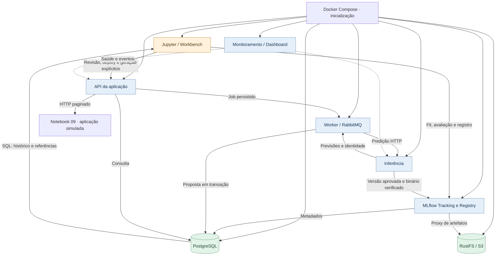

# Marista · Horários Inteligentes

**Da estrutura acadêmica à proposta de Planilha Turmas, com rastreabilidade ponta a ponta.**

Esta POC integra Jupyter, MLflow, PostgreSQL e RustFS para treinar modelos de demanda,
publicar versões aprovadas e gerar propostas consultáveis pela API. Todos os serviços
executam em containers Docker Compose.

[Começar](#começar) · [Arquitetura](#arquitetura) · [Acessos](#acessos) · [Jupyter](#jornada-no-jupyter) · [Documentação](docs/README.md)

> **V4 demonstrativa.** A estrutura vem de 107 registros de planejamento fornecidos;
> o histórico de matrículas é sintético e reproduzível. Os resultados comprovam a
> integração técnica, sem representar qualidade preditiva ou aprovação acadêmica institucional.

## O que a POC entrega

| Entrada | Processamento | Resultado |
|---|---|---|
| 3 planilhas de referência, 70 ofertas e 107 atividades | Importação com proveniência, validação e quarentena | Dados persistidos e auditáveis no PostgreSQL |
| Histórico sintético por coorte e disciplina | Treinamento local no Workbench, avaliação temporal e baseline | 3 modelos por curso, com versões e artefatos no MLflow/RustFS |
| Versões explicitamente aprovadas | Inferência operacional, composição e gravação transacional | Proposta de Planilha Turmas, tabela HTTP e auditoria de integridade |

Uma oferta contém suas atividades. Por exemplo, P164 preserva **41 estudantes
planejados na teoria e 21 + 20 nas práticas**: isso não representa 82 estudantes.
Capacidade oficial e unificação permanecem pendências explícitas quando faltam dados ou anuência.

## Começar

Pré-requisitos: Docker Desktop com containers Linux, Git e Python 3.11/3.12 para
os scripts administrativos. Referência inicial: 8 GiB disponíveis para Docker;
o Jupyter tem limite de 3 GiB e concorrência de 1 a 2 treinamentos simultâneos.

Na raiz do repositório, em PowerShell:

```powershell
# Primeira instalação
.\deployment\scripts\compose.ps1 init

# Instalação existente: atualizar imagens e migrations, preservando dados
.\deployment\scripts\compose.ps1 rebuild

# Uso diário
.\deployment\scripts\compose.ps1 start
.\deployment\scripts\compose.ps1 status
```

Coloque as três planilhas em [`data/reference/`](data/reference/README.md).
O Jupyter as recebe em `/reference`, somente para leitura; nenhuma macro é executada.
Abra [00 — Ambiente](http://localhost:8888/lab/tree/notebooks/00_ambiente.ipynb)
e siga a jornada abaixo. A preparação do ambiente não treina nem aprova modelos.

O inicializador cria o `.env` local quando necessário. Os nomes das configurações
estão em [`.env.example`](.env.example); preserve as credenciais de instalações
com dados. [Instalação Windows](docs/installation/WINDOWS.md) · [Linux](docs/installation/LINUX.md).

## Arquitetura



O **Workbench treina**; o **worker gera propostas usando inferência**. A API consulta
dados persistidos. O serviço de inferência usa PRELOAD seletivo ou LAZY, com cache
limitado a quatro versões por processo. O adaptador `ingestion` continua disponível
para compatibilidade; a importação V4 ocorre no Workbench.

**Registrar → validar → aprovar → disponibilizar → carregar** são estados distintos.
Cada chamada confere aprovação SQL e alias do Registry, inclusive com cache aquecido.
O [mapa C3](docs/operations/C3_TRAINING.md) detalha responsabilidades e limites.

## Acessos

As credenciais ficam no `.env` local. Os links abaixo são para o navegador da máquina.

| Interface | Endereço | Credencial |
|---|---|---|
| JupyterLab | [localhost:8888](http://localhost:8888/lab/tree/notebooks/00_ambiente.ipynb) | `JUPYTER_TOKEN` |
| MLflow | [localhost:5000](http://localhost:5000) | Acesso local por loopback |
| **RustFS — console** | [localhost:9001](http://localhost:9001) | `AWS_ACCESS_KEY_ID` / `AWS_SECRET_ACCESS_KEY` |
| API / OpenAPI | [localhost:8000/docs](http://localhost:8000/docs) | `API_TOKEN`; decisões técnicas usam `OPERATOR_TOKEN` |
| Dashboard de logs | [localhost:8088](http://localhost:8088) | `DASHBOARD_TOKEN` |
| RabbitMQ | [localhost:15672](http://localhost:15672) | Usuário `poc`; `RABBITMQ_PASSWORD` |

Entre containers, use DNS internos: `mlflow:5000`, `api:8000`, `inference:8001`
e `rustfs:9000`. Endereços internos não são links de navegador.
[Todos os acessos e verificações](docs/operations/ACESSOS.md).

## Jornada no Jupyter

Abra as cópias editáveis em `notebooks/` no Jupyter. Em cada arquivo, use
**Kernel → Restart Kernel and Run All**. `Shift+Enter` renderiza Markdown e
`Ctrl+S` salva. Reinícios preservam edições; atualizações arquivam a cópia anterior
em `workspace/notebook-backups/` antes de distribuir a nova versão.

| Etapa | Notebook | O que conferir |
|---|---|---|
| Preparar | **00** ambiente · **01** fontes · **02** qualidade · **03** exploração | SQL, artefato diagnóstico, origens, quarentena e snapshot sintético |
| Treinar | **04** individual · **05** campanhas | Fit real, seleção de métricas, novo experimento e links para o MLflow |
| Avaliar | **06** avaliação | Baseline e métricas por alvo e janela temporal |
| Decidir | **07** governança | Versões candidatas; aprovação técnica explícita |
| Gerar | **08** publicação e inferência | Deploy, job operacional e proposta persistida |
| Consumir | **09** aplicação · **10** auditoria | Tabela via HTTP, filtros e confronto SQL/Registry/RustFS |
| Reiniciar ensaios | **11** reset | Plano de limpeza seletiva; execução pelo controlador externo |

Para a proposta dos três cursos, execute **05**. No **07**, revise as versões e
habilite `APPROVE_DEMO`. No **08**, habilite `DEPLOY_DEMO` e `GENERATE` quando quiser
publicar e gerar. O contexto leva a proposta ao **09** automaticamente.
[Catálogo completo](notebooks/README.md) · [Roteiro detalhado](docs/operations/POC_V4_MANUAL_RUNBOOK.md).

### Campanhas e experimentos

O padrão é **NEW**: cada execução da célula de treinamento cria uma campanha e
um experimento próprio, com data UTC e UUID. As runs de lote e modelo ficam dentro
desse experimento. Modelos mantêm nomes estáveis no Registry e recebem novas versões.

Para continuar um ensaio interrompido, escolha **RESUME** e informe sua
`RESUME_REQUEST_KEY`. A retomada reutiliza o checkpoint; não cria outro experimento.
Uma chave inexistente é rejeitada. [Entenda repetição e Traces](docs/operations/EXPERIMENTS_AND_TRACING.md).

### Reset preservando a origem

`rebuild` preserva os dados. Para limpar os ensaios, o modo **reset-experiments**
remove MLflow, versões de objetos no RustFS e resultados derivados no banco,
mantendo referências e histórico sintético SQL com os mesmos IDs e hashes.
Arquivos locais e backups existentes são preservados.

O notebook **11 não apaga ao executar Run All**: apresenta os comandos de preview
e execução do controlador no PowerShell. [Escopo e procedimento de reset](docs/operations/RESET_POC.md).

## Onde os dados ficam

| Dado | Destino |
|---|---|
| Referências e histórico sintético | `planejamento_db.planning`: tabelas `academic_*` e `model_training_observations` |
| Campanhas e checkpoints | `planning.workbench_campaigns`, `workbench_models` |
| Aprovações e deployments | `planning.model_approval_requests`, `academic_deployments` |
| **Proposta final da IA** | **`planning.ai_proposals_v2`, `ai_proposal_offers_v2`** |
| Experimentos, runs, Traces e Registry | `mlflow_db`, administrado pelo MLflow |
| Binários e manifests | RustFS, bucket `pucpr-poc`; binários gravados pelo proxy MLflow |

O Jupyter lê SQL por `SOURCE_DATABASE_URL`. O worker grava a proposta em transação
no banco de negócio. A API entrega `GET /v2/proposals/{id}/application-view`
com filtros, paginação e hash. [Contrato HTTP](docs/contracts/academic_application_v2.md)
· [Consultas SQL](docs/operations/POSTGRES.md).

## Validação e próximos passos

A [rodada V4](artifacts/reports/v4/acceptance-v4.md) registra 12 notebooks em kernels
novos, 11 serviços saudáveis, 136 testes aprovados e a verificação específica do
Workbench. Inclui persistência após rebuild e inferência após restart com Jupyter parado.
Os [ajustes posteriores](artifacts/reports/v4-adjustments/README.md) têm evidências próprias.

Permanecem separados da validação automática: inspeção visual pelo usuário,
CI remota, capacidade institucional, integração PRIME e aprovação acadêmica.
Não foi realizado ensaio V4 de 500 modelos simultâneos.

Para diagnóstico: `docker compose logs --tail 100 api inference worker mlflow`.
Consulte [solução de problemas](docs/troubleshooting/README.md) e o
[índice da documentação](docs/README.md). `dev/` e `history/` são locais e ignorados pelo Git.
