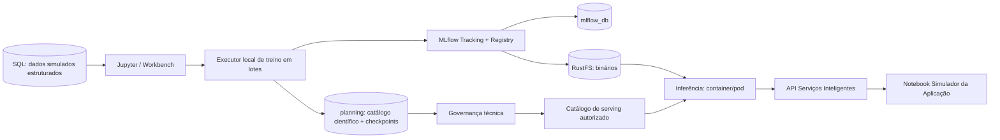

# SPEC V4 — Remodelagem da POC IA | Horas Inteligentes / Planilha Turmas

**Versão:** 4.0  
**Data:** 05/11/2026  
**Destinatário:** Codex, repositório `Quanticoi/marista-horas-intel-poc-ia`, branch `development`  
**Objetivo operacional:** concluir uma POC executável, tecnicamente aderente ao C3, academicamente coerente com as referências fornecidas e verificável visualmente de ponta a ponta.  
**Natureza dos dados:** dados estruturais extraídos de planilhas de planejamento 2024.2 + histórico **sintético controlado** para ensaio científico. Não representa matrícula oficial realizada, contrato homologado nem previsão estatisticamente validada em produção.

> **ORDEM AO CODEX — EXECUTAR, NÃO APENAS DOCUMENTAR.** Antes de editar, estudar este documento, os arquivos de referência, o HEAD da `development`, os módulos existentes e os testes. Implementar em fases curtas, manter a POC iniciável, executar testes reais e registrar evidências. Não recriar o repositório, não abandonar MLflow/RustFS/PostgreSQL/API, não remover automaticamente dados anteriores e não declarar PASS para etapas não executadas. A conclusão exige o notebook **Simulador da Aplicação** exibindo uma tabela real recebida integralmente da API, cuja origem seja demonstrável no Workbench, MLflow, Registry, storage e banco.

---

## 0. FONTES DE VERDADE E DECISÕES JÁ TOMADAS

### 0.1 Arquivos de entrada obrigatórios

No pacote acompanhante estão:

1. `reference/Planilha de Turmas 2024.2_Engenharia de Computação.xlsm` — planejamento acadêmico, atividade e divisões.
2. `reference/Planilha de Turmas 2024.2_CiberSegurança.xlsm` — segundo curso, disciplinas, eletivas.
3. `reference/DADOS-EXTERNOS-OTIMIZACAO-HORARIOS-V3.xlsx` — **contrato/mapeamento de entidades e campos da aplicação**, não histórico transacional materializado.
4. `reference/REQ_InteligenciaeOtimizacaodeHorariosAcademicos_V4.4 (1).pdf` — referência funcional e regras de negócio.
5. `reference/PUCPR - Otimização de Horários Inteligentes - Arquitetura de Componentes-V3(2).pdf`, `...Containers-V3(1).pdf`, `...Diagrama de Sequencia-V3(1).pdf` — arquiteturas C2/C3 e sequência de referência.
6. `reference/diagnostico_dados_simulacao_realista_horas_inteligentes.md` — análise prévia, mapeamentos, cenários e lacunas.

Copiar as planilhas de referência para diretório **somente leitura** do projeto, por exemplo `data/reference/` (não disponibilizar esses XLSM para execução de macros). Referenciar o SHA256 dos arquivos originais no catálogo de fontes. Se algum arquivo do pacote não estiver acessível no workspace do Codex, registrar `SOURCE_MISSING` e interromper **somente** a fase que depende dele; não substituir silenciosamente por dados inventados.

### 0.2 Precedência e fronteiras

- Regras funcionais V4.4 prevalecem para significado acadêmico; o documento de dados externos V3 prevalece para nomes de entidades/campos previstos na APP, **sem afirmar que constituem API homologada**.
- C3 V3 define **treinamento no Workbench/Jupyter** e **serviços/pods operacionais de inferência**; Docker Compose é a materialização da POC, não uma implantação GKE.
- Preserve `HI-LINEAGE/1.0` e `HI-LINEAGE/1.1`, migrations, catálogo e evidências anteriores por compatibilidade; evolua aditivamente para versão 1.2 apenas quando necessário.
- Modelo **treinado** ≠ **validado** ≠ **aprovado** ≠ **disponibilizado** ≠ **carregado em memória**.
- Aprovação **técnica de modelo** ≠ validação **acadêmica** da proposta pelo coordenador/GQA.
- Trabalhadores operacionais da API **NÃO treinam**. Todo fit, tuning, cross-validation e consolidação científica de campanhas executa no processo/recursos alocados ao **Workbench** (Jupyter ou processo local filho do container Jupyter); SQL/MLflow/RustFS são serviços acessados por rede.
- Notebook de aplicação final **não importa módulos de treino nem conecta diretamente no SQL ou RustFS para produzir sua tabela**. O resultado visível vem exclusivamente do contrato HTTP da API.

### 0.3 Achados comprovados que devem ser reproduzidos

- Engenharia de Computação 2024.2: **82 linhas preenchidas** de `DISCIPLINAS REGULARES`, **26 códigos distintos** de disciplina; códigos de curso **2248 (manhã)** e **2348 (noite)**, com grades e atividades diferentes; esses dois códigos não devem ser fundidos por nome.
- CiberSegurança 2024.2: **25 linhas**, **24 códigos distintos** de disciplina; curso **2287**, noturno; disponibilidade para eletivas é um sinal de elegibilidade, **não quantidade de alunos eletivos**.
- Total de linhas de planejamento de referência: **107**. Nenhuma deve ser descartada silenciosamente por deduplicação.
- Exemplo de Engenharia, `P164 — Concepção de Circuitos Elétricos` (curso 2248, período 4, manhã, grade `CECP 2023/1`): atividade teórica completa **41 previstos / 45 vagas**; prática `P2-1` **21 / 22**; prática `P2-2` **20 / 23**. São **atividades/divisões da mesma disciplina**, NÃO 82 alunos únicos.
- `P110A — Implementação e Operação de Projeto Transformador`: várias divisões `P30-*`; não representam disciplinas distintas.
- Em CiberSegurança, no período 2, seis disciplinas com previsão **46** e oferta **50** podem compartilhar a **coorte regular**, mas cada uma pode ter adicionais próprios (dependência/eletiva).
- A planilha de dados externos V3 descreve **30 entidades / 175 campos**. `HISTORICO_OCUPACAO_TURMA`, `DEMANDA_DISCIPLINA` e `GRADE_CURRICULAR_DISCIPLINA.modulacao` apresentam lacunas de disponibilidade ou derivação: não afirmá-las disponíveis como fatos consolidados.

**Dados observados na planilha 2024.2 são valores planejados, não realização de matrícula.** Nunca usar `previsão` ou `vagas desejadas` de 2024.2 como *ground truth* de ocupação real em uma avaliação científica.

### 0.4 Código legado que deve ser corrigido sem apagar histórico

- `src/data/synthetic.py`: não usar mais sorteio livre de quantidades campus/curso/período como fonte da simulação principal.
- `sql/queries/journey_history.sql`: **proibido** somar `regular + dependency + elective` na coorte e replicar o total idêntico para cada disciplina via `JOIN planning.period_disciplines` como se fosse target real.
- `src/data/journey.py`: a identidade `course_id + period_id + discipline_id` é insuficiente para oferta, matriz, turno e coorte; manter adaptador legado, criar novo contrato canônico.
- `src/operations/training.py` e `src/operations/jobs.py`: remover o **processamento de treino do worker operacional** da jornada principal. Preservar orquestração de inferência e geração na API/worker. Descontinuar com segurança endpoints legados de campanha de treino ou convertê-los em consulta/registro sem realizar fit no worker.
- `src/persistence/journey.py`: abandonar regra genérica `capacity=40` para simulação acadêmica principal; modulação depende da matriz/atividade e da ordem unificação → modulação.
- `src/api/proposal_contract.py`: entregar filtros acadêmicos e componentes de demanda, não somente IDs DEMO e `students.total`; versionar novo contrato sem quebrar `poc-planilha-turmas-v1`.

---

## 1. RESULTADO MÍNIMO PARA CONCLUIR A POC

Demonstrar três cenários acadêmicos, com os serviços operacionais já de pé:

**S01 — Circuitos Elétricos P164:** uma oferta de disciplina e três atividades (teórica completa; práticas P2-1 e P2-2), com `41` previstos no planejamento de referência e divisão 21+20 nas práticas; distinguir `reference_planned` de `simulated_actual` e `ai_estimated`, sem somar artificialmente essas atividades como alunos únicos.

**S02 — CiberSegurança:** curso 2287, período 2, seis disciplinas associadas à coorte; simular **adicionais diferentes por disciplina** e preservar vínculo com mesma coorte. Mostrar por que as previsões finais não precisam ser todas 46.

**S03 — Uma disciplina/atividade especial e unificação pendente:** `P110A` e divisões pequenas ou uma sugestão de unificação mencionada na planilha de Engenharia; sem dados oficiais dos cursos parceiros e sem anuência, mostrar `CANDIDATE_PENDING_DATA` / `PENDING_APPROVAL`; não efetivar automaticamente.

Ao final, Notebook `09_simulador_aplicacao` exibe tabela com filtros de **ciclo, escola, curso, matriz, coorte, período, turno, disciplina, tipo de oferta e status**, que veio do endpoint API. Abrir o detalhamento da linha deve apresentar composição regular/dependência/eletiva, origem, atividades, propostas de grupos, exceções e a linhagem do(s) modelo(s).

**Não é meta** executar 500 modelos no dia do aceite. O treinamento de múltiplos modelos e seus lotes deve ser demonstrado com 3–5 identidades acadêmicas **realmente diferentes**; os 30/500 permanecem teste secundário de escala, somente se houver recursos e séries sintéticas coerentes.

---

## 2. PRIMEIRA RODADA (COLD START) — TRATAMENTO OBRIGATÓRIO

A V4.4 define em `RF205` (a) dados históricos institucionais **disponíveis a partir de 2022** como referência inicial e (b) resultados **validados após implantação** como feedback futuro. `RF204` exige preservar sugestão original, alterações e resultado validado; `RF206` impede que calibração altere restrições obrigatórias. `RGN023` define proposta por etapas com validação humana.

| Cenário | Histórico acadêmico 2022+ | Feedback validado pela nova aplicação | Decisão |
|---|---|---|---|
| Prod. primeiro ciclo A | Existe e foi reconciliado | Ainda não existe | Treino temporal onde suportado, baseline/regras, sem feedback da APP |
| Prod. primeiro ciclo B | Ausente, insuficiente ou não fornecido | Ainda não existe | Cold start por valores oficiais presentes, matrizes e regras, heurística/baseline explícito, `quality=NOT_EVALUATED` |
| Prod. ciclos seguintes | Existe ou evolui | Existe após validação | Pode avaliar calibração e evolução, sem alterar regras mandatórias |
| POC | **Histórico sintético condicionado** a planilhas 2024.2 | Feedback DEMO só se evento validado | Demonstra fluxo sem alegar acurácia institucional |

**Invariantes do cold start:**
1. Não exigir modelo treinado para disponibilizar a aplicação/serviços.
2. Não inventar ocupação real de 2022–2024 com base em planilhas de planejamento.
3. Se a amostra sintética permitir métricas, identificá-las `evaluation_data_class=SYNTHETIC`; nunca `REAL_VALIDATED`.
4. Se não houver histórico suficiente para uma disciplina, oferecer baseline/estratégia de compartilhamento explicitamente identificada e com motivo; não forçar Ridge em amostra inadequada.
5. Feedback humano intermediário, não aprovado, **não** pode alimentar automaticamente o treino.
6. Gravar `cold_start_strategy`, `data_completeness`, `history_window`, `feedback_cycles_count` e `fallback_reason` em catálogo, run e proposta.

---

## 3. MODELAGEM ACADÊMICA CANÔNICA

Implementar esquema aditivo `planning` com fatos e dimensões coerentes. Nomes sugeridos (o Codex pode adaptar às migrations existentes, documentando de-para):

### 3.1 Dimensões e identificadores

- `academic_source_files`: SHA256 do XLSM/XLSX, nome original, data de ingestão, `source_type`, sem executar macros.
- `academic_course_identity`: estabelecimento, escola, código de curso, nome, turno, vigência; **2248 ≠ 2348**.
- `curriculum_identity`: curso, grade, currículo/versão, períodos previstos, validade e vínculo com disciplina.
- `academic_cohort`: curso, ciclo de ingresso (`ingress_year`, `ingress_term`), grade, período curricular atual, turno, número de estudantes regulares **com origem**.
- `discipline_identity`: código de disciplina e descrição; código PRIME quando conhecido, sem criar equivalências não homologadas.
- `academic_offer`: ciclo-alvo, campus, escola, curso, matriz, turma/coorte, disciplina, período, turno, tipo (`REGULAR`, `DEPENDENCY`, `ELECTIVE`, `SPECIAL`), estágio da proposta.
- `offer_activity`: `offer_id`, tipo (`THEORY`, `PRACTICE`, `OTHER`), texto de modulação, division label (`P2-1`, `P2-2`, `P30-*` etc.), ordem, capacidade/regra, origem e `source_row_id`.
- `offer_unification_candidate`: propostas de unificação, códigos PRIME, origens, requisitos campus/escola/turno, validação da outra coordenação e GQA, status.
- `academic_mapping`: de-para entre códigos Excel e entidades V3/PRIME; resultado `MAPPED`, `UNMAPPED`, `AMBIGUOUS`, `SYNTHETIC_ONLY`.

### 3.2 Fatos independentes

- `cohort_regular_demand`: estudantes regulares por coorte/ciclo, valor, classe de dado e fonte.
- `discipline_nonregular_demand`: demanda por **disciplina/categoria/ciclo** (dependência, eletiva etc.) com origem, hipótese, fator e incerteza.
- `discipline_total_demand`: visão derivada por disciplina/ciclo, **uma contagem por oferta**, nunca soma de grupos/atividades.
- `activity_group_plan`: projeção das atividades/divisões após regras de unificação e modulação; grupos são filhos da oferta.
- `model_training_observations`: feature/target temporal, `target_name`, `data_class`, snapshot, split e códigos acadêmicos; não juntar labels de tipos diferentes.
- `ai_proposals_v2` / linhas e atividades: proposta imutável + status de validação da matriz, registros de decisões e feedback; preservar tabelas v1 legadas.

Toda linha importada deve ter `source_file_sha256`, `source_sheet`, `source_row_number`, `source_column`, `source_value` quando pertinente, e `transformation_version`. Chaves técnicas UUID podem existir internamente, mas as chaves de negócio originais permanecem recuperáveis.

### 3.3 Chave da oferta versus chave do treinamento

**Oferta:** `{cycle, estabelecimento, escola, course_code, grade_code, cohort_code, period, shift, discipline_code, offer_type}` e componentes auxiliares de atividade/divisão.

**Modelo:** não impor um modelo por oferta nem por linha do XLSM. Permitir modelos globais, por família, agrupados e especializados por série quando o histórico permitir. Registrar um **roteador de estratégia** que selecione modelo válido/baseline para cada `target` e escopo.

**Chave física de atividade:** `offer_id + activity_type + division_label + source_row_id`. `source_row_id` preserva registros repetidos para auditoria sem confundi-los com ofertas distintas.

### 3.4 Validação do importador

Obrigatório gerar `import_report.json` e tabela legível:
- 82 linhas Engenharia + 25 CiberSegurança = 107 registros originais rastreados;
- códigos 2248/2348/2287 preservados;
- `P164` reconstrói as três atividades sem dupla contagem;
- `P110A` mantém todas as divisões originais, mesmo com aparente repetição;
- linhas duplicadas de `PCS107A` investigadas: nenhuma exclusão sem justificativa;
- code/curso/grade/turno incoerente vai para quarentena, não para deduplicação silenciosa;
- célula vazia vira NULL + `MISSING_SOURCE` e não valor imputado como factual;
- planilha V3 gera dicionário de dados e relatório de prontidão, **não gera fatos de matrícula**.

---

## 4. SIMULADOR SEMISSINTÉTICO DETERMINÍSTICO

### 4.1 Geração condicionada e três classes de dado

Criar `src/simulation/` com contratos versionados e `scenario_manifest.json`. Aplicar **exatamente a mesma estrutura acadêmica importada**, produzindo históricos simulados para exercícios temporais.

`OBSERVED_IN_SOURCE`: valor diretamente presente no arquivo (ex.: `planned_students=41`, **planejado**).  
`SYNTHETIC_HISTORY`: valor de matrícula/ocupação inventado para treinamento DEMO, ligado à estrutura, com seed/regra declarados.  
`AI_ESTIMATE`: previsão calculada pelo modelo treinado sobre histórico sintético.  
`OFFICIAL_REFERENCE`: apenas se fonte institucional real futuramente for carregada e comprovada.

Não misturar classes; colunas `planned_students`, `offered_seats`, `simulated_occupied_students`, `predicted_students` devem ter semânticas distintas.

### 4.2 Mecânica explícita dos cenários (sem sorteio solto)

- Construir coorte por curso/ingresso/grade/turno, com `intake_size` sintético, retenção/progressão por semestre e calendário; perfis configuráveis de ingresso, evasão, reprovação, trancamento e sazonalidade.
- Determinar demanda regular da disciplina segundo coorte e presença na matriz vigente; só atribuir a estudantes elegíveis. Não criar matrículas regulares para disciplina fora da grade.
- Para cada disciplina, adicionar demanda de **dependência** baseada em perfis controlados de reprovação/retomada e ocupação anterior; para eletivas, usar habilitação curricular e perfil de preferência sintético, não `Sim => N estudantes`.
- Cada disciplina poderá ter adicional próprio, tornando seis disciplinas de mesmo período diferentes **sem mudar a base de regulares indevidamente**.
- Aplicar limites e regras de unificação somente quando dados/autorizações suficientes existirem; estado pendente na ausência.
- Aplicar modulação segundo regra de matriz por disciplina/atividade; reproduzir `P2-1`, `P2-2`, `P30-*` como divisões; as quantidades por divisão são alocações da demanda total e não populações independentes.
- Manter `seed`, `scenario_id`, `scenario_version`, `assumption_profile`, `source_file_sha256` e `ruleset_version` para reprodução.
- Permitir cenários `baseline`, `growth`, `decline`, `high_dependency`, `elective_pressure` **somente como hipóteses**, com intervalos documentados e determinismo.
- Histórico sintético pode cobrir ciclos a partir de 2022 como teste do RF205, mas o calendário usado deve ser factível. Definir valores de cada ciclo **independentemente do target futuro** para evitar leakage. Evitar usar o planejamento de 2024.2 como verdade histórica de matrícula.

### 4.3 Testes matemáticos de invariantes

- Soma de estudantes das divisões práticas compatível com a população atribuída à prática (quando grupos disjuntos); teoria e prática **não** são somadas para contagem de alunos únicos.
- `regular + dependency + elective` compõe a demanda **somente quando as categorias forem definidas como disjuntas e houver regra documentada**; caso contrário, registrar revisão necessária.
- Nenhuma estimativa pode ser negativa; limites de capacidade verificados por grupo após modulação.
- O histórico de um ciclo não usa dados posteriores ao cutoff de treino; split temporal (rolling-origin ou holdout temporal) configurável.
- Mesmo seed, planilhas e configuração => mesmos dados simulados e mesmos hashes lógicos; seed diferente => dataset diferente e lineage rastreado.
- Se faltar grupo/unificação/código real, apresentar `NOT_EVALUATED` ou `PENDING_DATA`, não completar como se fosse informação oficial.

---

## 5. TREINAMENTO COMPUTACIONAL **NO WORKBENCH**

### 5.1 Desvio a corrigir

O caminho atual `Notebook05 → API → Celery Worker → fit` está incorreto para a premissa de dimensionamento do C3. A versão alvo será:



- `fit()`, tuning e cálculo científico são feitos em processos dentro do container/instância Jupyter/Workbench, incluindo subprocessos locais limitados por `max_workers`; não criar pods de treino no cluster compartilhado.
- Notebook pode encerrar/reabrir a UI; campanhas persistem checkpoint no volume/DB, mas **se o Workbench parar o treino não continua em Celery**. Ao religar o Workbench, pode **retomar itens pendentes** com idempotência. Explicar isso claramente.
- A API de aplicação/worker **somente** recebe pedidos de proposta, compõe contratos, executa inferência e persiste resultados; **não faz fit**.
- Implementar executor local com limite conservador e parametrizável, sem prometer throughput de 500 modelos. Medir pico de memória/CPU e duração de lote.
- Manter API histórica de treino V2 apenas se for indispensável à compatibilidade; desativar seu uso no fluxo novo, marcar `LEGACY_DEPRECATED`, registrar ADR e comprovar que `Notebook05` não a utiliza.

### 5.2 Estratégia de famílias de modelos

Não fixar `1 modelo = 1 curso/período` nem `1 modelo = 1 disciplina`.

| Família | Target | Granularidade / observações |
|---|---|---|
| Ingresso/progressão de coorte | Regulares futuros quando não oficiais | Curso/coorte/ciclo, podendo ser modelo global com features |
| Dependência por disciplina | Adicionais por disciplina | Disciplina/grade/curso com pooling para série curta |
| Demanda eletiva | Adicionais elegíveis | Disciplina/segmento, com ausência legítima de histórico |
| Demanda total de oferta | Resultado composto | Preferir regra e agregação de componentes; só modelar diretamente se justificado e comparado com baseline |

Demonstrar no mínimo dois algoritmos/baselines e três escopos distintos. Catálogo de algoritmos deve aceitar extensões sem reescrever notebook. Não anunciar acurácia institucional por métricas de dados sintéticos.

---

## 6. CATÁLOGO DE MÉTRICAS HABILITÁVEIS E CONSOLIDAÇÃO NO MLFLOW

### 6.1 UX do catálogo no notebook

No Notebook `04` e `05`, mostrar uma tabela simples, **sem JSON cru**, com colunas: `Selecionar | Métrica | Categoria | Aplicável a | Interpretação | Agregação`.

Catálogo versionado e extensível (`metric_id`, `version`, função, task_type, unidades, direção, required_inputs, dependencies, aggregation_method, enabled_by_default, fallback/status`). Perfis editáveis versionados: `forecast_baseline`, `forecast_extended`, `academic_impact`, `compute_resource`.

**Candidatas, não obrigatórias todas:**
- Regressão: MAE, RMSE, MedAE, WAPE (somente denom. positivo), sMAPE com política de zero, R² (somente amostra válida), Bias/ME, erro absoluto P90, RMSSE/MASE quando baseline sazonal e histórico suficientes, intervalo de previsão/cobertura se aplicável.
- Impacto acadêmico: diferença de estudantes, excesso/falta de vagas e erro de número de grupos **quando existir verdade observada e regra validada**; para proposta ainda não validada usar indicador de simulação, não métrica de acurácia real.
- Operacionais: segundos de treino, CPU, pico RAM, tamanho do binário, sucesso/falha, volume de exemplos; esses têm registro **automático obrigatório** quando mensuráveis.
- Classificação, drift e monitoramento apenas se modelo/tarefa/dados exigirem; não calcular por hábito.

Valores inaplicáveis são `NOT_EVALUATED` com causa (ex.: denominador zero, série curta, ausência de ground truth), **nunca zero**.

### 6.2 Níveis de organização no MLflow

Organizar **um experimento por família/ciclo** com runs relacionáveis:

`Experimento → Campanha (run pai) → Lotes (runs agregadoras) → Runs individuais de modelos`.

O MLflow permite parent/child via tags de run; **não pressupor nativamente árvore de três níveis visualizada automaticamente**. Cada run terá tags explícitas `run_type=CAMPAIGN|BATCH|MODEL`, `campaign_id`, `batch_id`, `parent_run_id`, além de `model_key`, snapshot, data_class, metric_profile_version e algorithm quando aplicáveis. Usar `mlflow.parentRunId`/runs aninhadas quando suportado pelo SDK instalado; manter queries por tags para recuperar hierarquia mesmo se a UI não exibir todos os níveis.

**Run individual:** todas as métricas habilitadas e aplicáveis, baseline, dataset/escopo, versão do modelo, link Registry e manifesto S3.

**Run de lote:** `requested`, `completed`, `failed`, `not_evaluated`, `quality_eligible`, contagens de exemplos, métricas agregadas com método, distribuição p25/p50/p75/p90, segmentos de curso/matriz e relatório CSV/JSON.

**Run de campanha:** visão de todos os lotes, indicadores consolidados, tendências, qualidade e exceções, perfil de métricas/hashes, manifesto, tabela ordenada de modelos e versões. Registrar resultado parcial conforme lotes terminarem e final quando todos estiverem em estado terminal.

**Agregação estatística:**
- MAE global: `sum_abs_errors/sum_count` para população comparável.
- RMSE global: `sqrt(sum_squared_errors/sum_count)` — **não** média simples dos RMSEs.
- Bias global: `sum_signed_errors/sum_count`.
- WAPE global: `sum_abs_errors/sum_abs_actual` quando denominador adequado.
- Mediana/P90 globais: calcular da distribuição de erros agregada (ou registrar que é resumo entre modelos, não percentil global).
- R² global: recomputar sobre observações combinadas com ressalva de comparabilidade, não fazer média ingênua.
- Comparar modelos somente com mesma tarefa, target, horizonte e split, ou separar grupos para evitar rankings inválidos.

### 6.3 UX obrigatória no MLflow e no Jupyter

Mostrar em notebook, com `display(DataFrame)` formatado e gráficos simples: indicadores da campanha, barras de lotes, tabela de modelos ordenada por métrica habilitada, percentual de cobertura e candidatos elegíveis. Colunas com nomes legíveis e links diretos `Experimento`, `Run`, `Registry`, `Manifest RustFS`, `SQL`.

**Nomenclatura:**
- `experiment_name`: `HI/POC/PlanilhaTurmas/<familia>/<ciclo>`;
- `campaign_display_name`: `POC 2024.2 • Demanda acadêmica • Lote piloto`;
- `batch_display_name`: `Lote 01/03 • 3 modelos`;
- `run_name`: `<model_key>__<algorithm>__<UTC>__a<attempt>`;
- model version é nativa do Registry, com alias `candidate` quando aplicável; `champion` somente quando aprovado.

Incluir artefatos da campanha: `metric_catalog.json`, `campaign_summary.json`, `batch_summary_*.json`, `model_metrics.csv`, `model_errors.csv`, `quality_gates.json`, `data_contract.json`, `lineage_manifest.json`. O MLflow controla armazenamento físico no RustFS; índices adicionais sob `lineage/` sem copiar binários.

---

## 7. NOVA JORNADA DE NOTEBOOKS — 00 A 11

**Regra de UX:** notebooks curtos, títulos claros e seções consistentes: **Objetivo** (uma frase), **Entradas** (campos), **Executar** (ação), **Resultado** (tabela/gráfico), **Onde conferir** (links). Mensagens curtas e diagnósticas; ocultar debug/stack traces atrás de seção de diagnóstico. Código complexo em `src/`, não em células de 200 linhas.

| Nº / Arquivo novo | Função | Operação e evidência obrigatória |
|---|---|---|
| `00_ambiente.ipynb` | Preflight | Saúde dos serviços, versão, catálogos, DBs, URL e status de modelos disponíveis; sem treino |
| `01_fontes_academicas.ipynb` | Importação/mapeamento | Inspeciona 107 registros, planilha V3, ambiguidades, de-para, `source_file_sha256` |
| `02_qualidade_dados.ipynb` | Sanidade acadêmica | Chaves, grade, grupos, nulos, duplicidades, source lineage, P164/P110A |
| `03_exploracao_demanda.ipynb` | Visão científica | Coortes, disciplinas, dependências, eletivas, séries sintéticas por ciclo, gráficos com classes de dado separadas |
| `04_treinamento_modelos.ipynb` | Treino individual **no Workbench** | Seleção escopo/target/algoritmo/perfil métricas, fit real, run, Registry, S3, SQL |
| `05_campanhas_lotes.ipynb` | Treinamento por lotes **no Workbench** | Lotes configuráveis, progresso, checkpoints/retry, MLflow parent/batch/model runs, métricas consolidadas |
| `06_avaliacao_modelos.ipynb` | Decisão científica | Comparação válida por target/split/horizonte, baseline, qualidade, explicação das restrições |
| `07_governanca_registry.ipynb` | Aprovação técnica | Candidatas, verificações de binário/assinatura, aprovação com operador, conciliação SQL/Registry, revogação |
| `08_publicacao_inferencia.ipynb` | Disponibilização operacional | Elegibilidade, status no catálogo, preload seletivo, cache, endpoints, teste pós-restart |
| `09_simulador_aplicacao.ipynb` | **Aceite funcional final** | Consome **exclusivamente HTTP da API**, exibe DataFrame com filtros e detalhamento de oferta; sem import de treino/SQL |
| `10_auditoria_lineage.ipynb` | Auditoria reversa | Proposta → disciplina → inferência → modelo/versão → run → experimento → artefato, statuses reais |
| `11_reset_poc.ipynb` | Inspeção/reset | Preview, escopo e verificação pós-limpeza; destrutivo somente controlador externo e isolado |

**Migração amigável:** guardar notebooks antigos em `notebooks/legacy/` versionados e documentados; evitar duplicatas editáveis no Jupyter. Cópias editadas no workspace devem ser preservadas com backup, não sobrescritas silenciosamente. README deve oferecer **um fluxo principal** `00 → 01 → 02 → 03 → 04/05 → 06 → 07 → 08 → 09 → 10` e reset como ferramenta excepcional.

### 7.1 Template visual mínimo dos notebooks 04 e 05

1. **Cabeçalho:** `05 | Treinamento em Lotes`, subtítulo de 1 linha e versão de cenário.
2. **Parâmetros:** ciclo; snapshot; família/target; curso/matriz/disciplina; algoritmo; quantidade de modelos; tamanho de lote; `max_workers` do Jupyter.
3. **Métricas:** tabela com checkboxes habilitáveis (ipywidgets ou mecanismo equivalente instalado, não controles decorativos); botão/ação salvar perfil; impedimento de seleção incompatível com tarefa.
4. **Prévia:** contagem de séries distintas e amostras; mensagens de impedimento (histórico curto, fonte ausente), orçamento simples de CPU/RAM.
5. **Execução:** progressão lotes/modelos, falhas com causa e ação, não despejar JSON/trace em tela.
6. **Resultado:** cards textuais, tabela por modelo, gráfico por lote e lista de alertas; todas as métricas com unidades.
7. **Onde conferir:** links reais MLflow experimento/run/Registry, RustFS/manifest, SQL catálogo, dashboard.
8. **Evidências:** `batch_report.json`, `.csv`, `campaign_report.json`, sem credenciais; `PASS` somente com execução real.

---

## 8. POLÍTICA DE ELEGIBILIDADE, APROVAÇÃO E PUBLICAÇÃO

### 8.1 Máquina de estados do modelo

`TRAINED → VALIDATED → APPROVED → DEPLOYED → LOADED` com caminhos para `REJECTED`, `REVOKED`, `FAILED`, `UNAVAILABLE`. Esses estados têm significados diferentes e persistência auditável, sem assumir que o MLflow Registry possui todos esses estados nativamente.

**VALIDATED:** run concluída, dados/snapshot/referências íntegros, métricas aplicáveis, assinatura de I/O e artefato verificável; critérios de qualidade configuráveis por família.  
**APPROVED:** decisão humana técnica registrada, com versão explícita, revisor e justificativa; reconciliada com `champion` no MLflow.  
**DEPLOYED:** versão incluída em catálogo operacional de serving (ambiente, modo, roteamento, validade, custo).  
**LOADED:** binário residente no processo atual (cache/processo/instância), observável por endpoint. Um modelo pode ser `DEPLOYED` e não `LOADED` (carregamento lazy).  
**REVOKED:** bloqueia novas inferências, inclusive em cache aquecido.

**Não selecionar versão por `latest`, número maior, melhor MAE isolado nem simples tag de validação.** A única fonte de autorização é o catálogo operacional SQL reconciliado com a versão/alias nativa do Registry.

### 8.2 Catálogo de serving

Implementar/adaptar views ou tabelas aditivas no `planejamento_db.planning`, com `model_key`, família, target, escopo, `registered_model_name`, `model_version`, `run_id`, `artifact_uri`, `artifact_sha256`, `signature_hash`, status de validação, aprovação, publicação, compatibilidade de entrada/saída, ambiente, política `PRELOAD|LAZY`, revisão e data de expiração.

Verificações bloqueantes antes de `DEPLOYED`: `run FINISHED`, evidência métrica/perfil, snapshot, artefatos no RustFS, SHA/assinatura, status `APPROVED`, alias e autorização SQL concordantes, rota compatível. Dados DEMO só podem ser publicados no ambiente POC, sem routeamento acidental em ambiente institucional.

### 8.3 Startup e serving (C3)

**Ao subir os containers:** `mlflow`, `api`, `inference`, `monitoramento`, `postgres`, `rustfs`, `rabbitmq`, `worker` e `jupyter` ficam operacionais; nenhum treino automático. Serviço de inferência lê **catálogo de modelos disponibilizados**.

- `PRELOAD`: carrega seletivamente modelos designados; verificar checksum e assinatura.
- `LAZY`: versão fica elegível sem ocupar RAM até solicitação; depois usa cache de tamanho configurável.
- `GET /internal/models/catalog`: lista registrados, validados, aprovados, deployados e loaded (somente dados permitidos), diferenciando readiness.
- `GET /internal/models/runtime`: loaded versions, last_used_at, cache hits/misses, cache size, erros e duração de load.
- API de inferência retorna versão real, `run_id`, `inference_id` e `proposal_id` (quando existente), sem expor credenciais ou caminhos sensíveis.
- Após `docker compose restart inference` ou restart do pod, `PRELOAD` volta quando aplicável e `LAZY` recarrega sob demanda do RustFS. Jupyter pode estar parado.
- Não hospedar 500 modelos na RAM por padrão; decidir memória/cache a partir de medidas de footprint e frequência de uso.

**Importante:** a API de aplicação/worker **não treina** nem promove versões. Ela solicita inferência a serviços sempre disponíveis e persiste a proposta da aplicação.

---

## 9. CONTRATO JSON IA → APLICAÇÃO E NOTEBOOK 09

### 9.1 Contrato versionado

Propor `poc-planilha-turmas-v2` (sem substituir a v1) e `OpenAPI/JSON Schema` tipado. Chaves acadêmicas compatíveis com o documento de dados V3, preservando códigos e mapeamentos. IDs não confirmados ficam `null`, com `mapping_status`, **nunca IDs PRIME inventados**.

Exemplo **ilustrativo de formato**, não linha de previsão efetivamente produzida:

```json
{
  "schema_version": "poc-planilha-turmas-v2",
  "contract_status": "PROVISORIO_PENDENTE_HOMOLOGACAO",
  "proposal_id": "<uuid_da_execucao>",
  "cycle_code": "2024-2",
  "phase": "REGULAR_MATRIX_DRAFT",
  "source_type": "SEMI_SYNTHETIC_POC",
  "status": "DRAFT_PENDING_COORDINATOR",
  "offers": [
    {
      "offer_id": "<uuid_tecnico>",
      "academic": {
        "establishment": "Curitiba", "school": "Politécnica",
        "course_code": "2248", "course_name": "Engenharia de Computação",
        "curriculum_code": "CECP 2023/1", "period": 4,
        "cohort_ingress": null, "shift": "Manhã",
        "discipline_code": "P164", "discipline_name": "Concepção de Circuitos Elétricos",
        "offer_type": "REGULAR", "prime_ids": null,
        "mapping_status": "SYNTHETIC_ONLY"
      },
      "demand": {
        "regular": {"value": null, "data_class": "NOT_AVAILABLE"},
        "dependency": {"value": null, "data_class": "NOT_AVAILABLE"},
        "elective": {"value": null, "data_class": "NOT_AVAILABLE"},
        "estimated_total": null, "uncertainty": null,
        "reference_planned_students": 41
      },
      "activities": [
        {"kind": "THEORY", "division": "Completa", "reference_planned_students": 41, "reference_seats": 45},
        {"kind": "PRACTICE", "division": "P2-1", "reference_planned_students": 21, "reference_seats": 22},
        {"kind": "PRACTICE", "division": "P2-2", "reference_planned_students": 20, "reference_seats": 23}
      ],
      "unification": {"status": "NOT_EVALUATED", "requires_approval": true},
      "modulation": {"status": "REFERENCE_ONLY", "rule_version": null},
      "lineage": {"snapshot_id": "<uuid>", "model_usages": [], "ruleset_version": "<version>"},
      "warnings": ["Planejamento 2024.2 nao e ocupacao observada"]
    }
  ],
  "total_rows": 1, "limit": 100, "offset": 0
}
```

Na geração efetiva, valores `regular`, `dependency`, `elective` e `estimated_total` devem ser populados **quando houver simulação válida e/ou modelo**, com `data_class`, `source_ref`, `model_key/version` e campo de confiança quando calculável; não permanecer todos nulos por mero descuido da implementação. O exemplo acima mostra o estado de pré-importação/previsão.

### 9.2 Duas visões distintas no contrato

1. `offers`: **uma linha lógica por oferta de disciplina**, sem multiplicar por atividades.
2. `offer.activities`: subitens de modulação/atividade com capacidade e grupos, respeitando ordem/unificação/validação.

Devolver paginação determinística, `payload_sha256`, `proposal_revision`, filtros e mensagens de pendência. O contrato deve ser **consumível pela aplicação** sem reconstrução de relações a partir de SQL externo.

### 9.3 Simulador da APP — Notebook 09

O notebook faz apenas HTTP autenticado para `GET /v1/proposals/{proposal_id}/application-view` (ou rota v2 específica), pagina até obter o resultado completo, valida schema, hash e paginação; renderiza **tabela filtrável** com colunas:

`Estabelecimento | Escola | Curso | Grade | Turma/Ingresso | Período | Turno | Disciplina | Regular | Dependência | Eletiva | Total previsto | Atividades/Grupos | Unificação | Status`.

Usar `ipywidgets` para filtros claros, se disponível; caso contrário `pandas`/HTML com controles efetivos e tabela atualizada por parâmetro. Selecionar linha exibe subitens teóricos/práticos, origem e links de lineage; **nenhum treinamento, composição acadêmica ou leitura SQL** dentro desse notebook.

O notebook **não deve** importar `src.training`, `src.data.journey`, `src.persistence`, `mlflow` nem `boto3` para produzir a tabela. Credencial via variável de ambiente e nunca mostrada.

---

## 10. REVISÃO DO README, ESTRUTURA DO REPOSITÓRIO E TAGGING

### 10.1 README operacional — rota de aceitação

Na capa do README: diagrama C3 preservado, quickstart, tabela de portas/serviços, e **uma jornada do início ao fim**: `start → importar → simular → treinar no Jupyter → ver métricas no MLflow → validar/aprovar → disponibilizar → reiniciar inferência → consumir API no Notebook 09 → auditoria`.

Criar `docs/operations/POC_V4_MANUAL_RUNBOOK.md` com comandos Windows PowerShell e Linux, requisitos de CPU/RAM e o que observar em cada ferramenta. Distinguir execução do Workbench vs serviços permanentes. Não misturar etapas `legacy` como se fossem padrão.

### 10.2 Catálogo único de navegação

Tags em todos os destinos: `solution_id`, `environment`, `domain`, `cycle_code`, `course_code`, `curriculum_code`, `cohort_id`, `discipline_code`, `offer_id`, `data_class`, `scenario_id`, `snapshot_id`, `model_family`, `target_name`, `metric_profile`, `campaign_id`, `batch_id`, `model_key`, `run_id`, `registered_model_name`, `model_version`, `artifact_sha256`, `ruleset_version`, `proposal_id`, `inference_id` **quando aplicáveis**.

Metadados de apresentação `display_name` e identificadores técnicos devem coexistir. Não colocar 500 hashes no nome de experimento; não sobrescrever internals de `mlflow/`. Criar manifests legíveis em `lineage/` com referências físicas reais e SHA256; referências no PostgreSQL e links em notebooks.

**Estado de integridade:** `RECORDED` na gravação não equivale a `VERIFIED`; este só é resultado da auditoria cruzada MLflow/SQL/S3/contrato. Respeitar a migration 009 e fluxo `RECONCILING` de governança já implementados.

### 10.3 Estrutura alvo sugerida

```text
notebooks/00_ambiente.ipynb
notebooks/01_fontes_academicas.ipynb
notebooks/02_qualidade_dados.ipynb
notebooks/03_exploracao_demanda.ipynb
notebooks/04_treinamento_modelos.ipynb
notebooks/05_campanhas_lotes.ipynb
notebooks/06_avaliacao_modelos.ipynb
notebooks/07_governanca_registry.ipynb
notebooks/08_publicacao_inferencia.ipynb
notebooks/09_simulador_aplicacao.ipynb
notebooks/10_auditoria_lineage.ipynb
notebooks/11_reset_poc.ipynb
notebooks/legacy/                 # notebooks anteriores versionados
src/academic/                     # parser, contratos e normalização
src/simulation/                   # histórico sintético condicionado
src/workbench/                    # executor local, métricas, lotes, relatórios
src/serving/                      # catálogo/eligibilidade e gestão de load
src/api/                          # contrato aplicação, endpoints, autenticação
src/persistence/                  # migrations e views aditivas
config/metric_catalog.yaml
config/metric_profiles/*.yaml
sql/queries/v4_*.sql
docs/contracts/planilha-turmas-v2.schema.json
docs/operations/POC_V4_MANUAL_RUNBOOK.md
artifacts/reports/v4/
```

Reutilizar componentes existentes quando adequados; não duplicar services por estética. `dev/spec_correcoes.v4.md` deve registrar a versão implementada da SPEC ou link referencial, sem apagar V1–V3.

---

## 11. PLANO DE EXECUÇÃO PARA CONCLUIR A POC COM SEGURANÇA

**Não implementar tudo em um único commit. Fases com checkpoint e testes; preservar a `development` funcional.** O Codex deve prosseguir sem pedir confirmação para mudanças não destrutivas e gerar evidências após cada fase.

### FASE A — Importação acadêmica (bloqueante)

- Ler 3 planilhas; descobrir abas/cabeçalhos; preservar todos 107 registros e os 30 conjuntos de entidades/175 campos do contrato V3; gerar dados canônicos no PostgreSQL com migrations aditivas.
- Validar P164, P110A, curso 2248/2348, curso 2287, duplicidades, eletivas e referências de unificação.
- Entregar `source_inventory.json`, `academic_mapping.csv`, `import_report.md`, `canonical_schema.md`.
- Gate: nenhuma transformação/training antes de integridade referencial e origem estarem auditáveis.

### FASE B — Simulação determinística e cold start

- Gerar histórico semissintético por coorte/disciplina/categoria com dados de exemplo desde 2022, cenários controlados, seed e testes temporais.
- Implementar cold start com baseline e `NOT_EVALUATED` quando inexistir histórico suficiente.
- Gate: S01/S02/S03 corretos e dados planejados ≠ dados sintéticos ≠ previsão.

### FASE C — Treinamento local, notebooks e métricas

- Mover **todo treino** da jornada principal para Workbench; criar executor de lotes local com checkpoint/retry e medição de memória.
- Implementar catálogo de métricas habilitáveis; criar runs MLflow de campanha/lote/modelo e consolidados matematicamente corretos.
- Entregar notebooks 00–06 com outputs curtos, métricas legíveis, gráficos e links.
- Gate: três modelos/escopos realmente diferentes, binários no RustFS, tags e métricas coerentes; desligar worker da aplicação durante treino e provar que treino continua nos recursos Jupyter (desde que serviços de storage/MLflow disponíveis).

### FASE D — Governança e serving

- Aprovar candidatas DEMO conscientemente; catalogar versões por escopo; publicar; subir/reiniciar inferência sem treino; testar preload seletivo e lazy.
- Aplicar reconciliação `RECONCILING`/SQL Registry e impedir versão revogada em cache.
- Gate: `inference` carrega versão elegível com Jupyter parado e **recusa** não aprovada no caminho operacional.

### FASE E — API e simulador da aplicação

- Versão 2 de contrato de oferta, serviços de proposta e filtros; atividades como filhos, matriz/coorte/turno preservados, origens de demanda e lineage.
- Notebook 09 consome exclusivamente API e apresenta tabela filtrável; notebook 10 audita binários/versões/tags.
- Gate: sucesso completo em S01/S02/S03, 107 origens preservadas e nenhuma atividade contada como matrícula independente.

### FASE F — Validação, README e CI

- Atualizar README, ADR C3/treinamento local, contrato, catálogo, runbook e evidências; testes em checkout limpo, migrations e preservação.
- Gate: CI verde e **checklist manual separado** (`MANUAL_NOT_CHECKED` até usuário inspecionar MLflow/RustFS/Jupyter/UI). Não inventar certificado de homologação funcional V4.4.

**Se houver bloqueio de tempo/recursos:** priorizar A+B+C (piloto 3 modelos)+D+E com cenários S01/S02, mantendo S03 como `BLOCKED/PENDING_APPROVAL` explicitamente na API. Não sacrificar separação de treino Workbench/serving nem integridade dos dados para declarar “100%”.

---

## 12. TESTES OBRIGATÓRIOS E CRITÉRIOS DE ACEITE

| ID | Requisito / evidência de PASS |
|---|---|
| V4-01 | 82 + 25 = 107 linhas do XLSM rastreadas a arquivo/aba/linha/células, sem perda |
| V4-02 | Curso 2248/manhã e 2348/noite não se confundem; curso 2287 noturno íntegro |
| V4-03 | P164 é uma oferta com teoria + duas práticas; contagem de estudantes não duplica |
| V4-04 | P110A mantém subdivisões; duplicações são auditadas e não apagadas arbitrariamente |
| V4-05 | Contrato de 30 entidades/175 campos classificado por fonte/prontidão; não confundido com histórico |
| V4-06 | Simulador determinístico por coorte/disciplina/categoria, com histórico e seed documentados |
| V4-07 | `planned`, `offered_seats`, `synthetic_actual` e `ai_predicted` permanecem conceitos diferentes |
| V4-08 | RF020–026: coorte/regular/adicionais por disciplina, quando dados disponíveis, com proveniência |
| V4-09 | RGN023, RF040–047 e RF117–125: ordem de decisão, candidato de unificação e modulação auditáveis |
| V4-10 | Cold start sem histórico de feedback APP; não usa feedback não validado |
| V4-11 | Fit/treino de múltiplos modelos acontece somente no Jupyter/Workbench; worker operacional não treina |
| V4-12 | Notebook 05 executa lotes com checkpoint, retry local, indicadores e UX visual objetiva |
| V4-13 | Catálogo habilitável/versão de métricas no notebook com testes de seleção e aplicabilidade |
| V4-14 | Métricas individuais e agregadas corretas nas runs MLflow de modelo/lote/campanha |
| V4-15 | Nomeação humana, run, versão, hashes e manifest rastreáveis Jupyter→MLflow→RustFS→SQL |
| V4-16 | Catálogo serving distingue TRAINED/VALIDATED/APPROVED/DEPLOYED/LOADED/REVOKED |
| V4-17 | Inferência carrega somente versões elegíveis no caminho operacional, sem Jupyter |
| V4-18 | Restart inferência conserva capacidade de servir versão registrada; revogação impede cache quente |
| V4-19 | API retorna `poc-planilha-turmas-v2` com oferta por disciplina e atividades filhas, filtros e JSON Schema |
| V4-20 | Notebook 09 produz tabela filtrável **exclusivamente de HTTP**, sem treino/SQL/MLflow no notebook |
| V4-21 | S01 P164, S02 CiberSegurança e S03 pendência/unificação comprovados com dados/códigos de referência |
| V4-22 | Notebook 10 reconstitui `proposal → inference → model/version → run → artifact` com integridade |
| V4-23 | Baseline da POC anterior preservado; migrações aditivas sem reset principal; backups de notebooks |
| V4-24 | CI limpa passa; testes unitários+integração+contrato+E2E; README/runbook atualizados |
| V4-25 | Evidências automáticas `AUTO_PASS`, manual `MANUAL_PASS` ou `MANUAL_NOT_CHECKED` explícitas, sem homologação fictícia |

### 12.1 Casos negativos obrigatórios

Reprovar, com mensagens claras e sem estado inválido: disciplina sem matriz; coorte sem fonte de regulares; duplicidade de atividades; discrepância entre soma de grupos e população atribuída; snapshot de ciclo errado; métrica incompatível; run incompleta; hash de artefato divergente; modelo revogado e cache quente; `champion` divergente do SQL; contrato HTTP paginado com duplicata; resposta sem atributo de filtro essencial; tentativa de treinar pelo worker operacional.

### 12.2 Checklist manual por componente

| Ferramenta | Operação manual | Evidência esperada |
|---|---|---|
| Jupyter 01/02 | Ver estrutura e qualidade de 107 linhas | Códigos, grades, atividades, quarentena |
| Jupyter 03 | Inspecionar coorte e categorias sintéticas | Séries e features coerentes, com legenda da classe do dado |
| Jupyter 04/05 | Treinar modelos e lote no Workbench | CPU/RAM local, progresso, runs, métricas e consolidados |
| MLflow Tracking | Abrir experimento/campanha/lote/run | Hierarquia por tags, gráficos e tabelas consolidadas |
| Model Registry | Abrir modelo por nome | Versões, métricas, origem e estado candidato/aprovado |
| RustFS | Abrir manifest e arquivos no prefixo MLflow | Object keys, tamanho, SHA e versão ligada à run |
| PostgreSQL | Consultas SQL de catálogo | Mesmo model_key/run/version/campaign/snapshot/proposal |
| Inferência | Parar Jupyter, reiniciar inferência e prever | Serviço carrega versão autorizada e registra inferência |
| Notebook 09 | Filtrar tabelas de ofertas recebidas via API | P164 sem dupla contagem, adicionais por disciplina |
| Notebook 10 | Auditar proposal_id e model_key | `VERIFIED`, `MISSING`, `MISMATCH` ou `LEGACY_PARTIAL` fundamentado |

---

## 13. CONTRATOS OPERACIONAIS / ENDPOINTS SUGERIDOS

Inspecionar rotas existentes e reutilizá-las. Propor novos endpoints somente quando contrato atual for insuficiente:

| Método/rota | Objetivo |
|---|---|
| `GET /v1/academic/scopes` | Catálogo de curso/grade/disciplina/turno/coorte com IDs de origem |
| `GET /v1/academic/data-quality` | Prontidão, ambiguidades e origem dos 107 registros |
| `GET /v1/workbench/metric-catalog` | Leitura da configuração de métricas; sem execução de treino na API |
| `GET /v1/serving/models` | Versões elegíveis/publicadas, status, modo de load |
| `POST /v1/serving/models/{model_key}/deploy` | Operação técnica explícita e autenticada, reconciliada com Registry |
| `GET /v1/serving/runtime` | Modelos residentes, cache e last_used |
| `POST /v1/proposals/generations` | Geração operacional de proposta usando inferência, sem fit |
| `GET /v1/proposals/{id}/application-view?schema_version=...` | Payload v2 paginado, filtrável, 1 oferta por disciplina |
| `GET /v1/audit/proposal/{id}` | Grafo/relatório de linhagem autenticado |

A UI de simulação não precisa de nova aplicação Next.js: basta Jupyter consumir API. Todos os endpoints mutáveis exigem autenticação, idempotência/validação de estado, auditoria e isolamento DEMO. Não permitir publicar modelos em produção por uma chamada DEMO.

---

## 14. FORMATO DE ENTREGA OBRIGATÓRIA DO CODEX

1. Commits pequenos por fase e `git diff --stat`; não fazer push destrutivo nem reset na principal. Se push não estiver permitido, entregar comandos exatos, branch e SHA local.
2. `artifacts/reports/v4/import-report.json`, `source-mapping.csv`, `scenario-manifest.json`, `training-evidence.json`, `metric-catalog.json`, `mlflow-campaign-summary.json`, `model-serving-check.json`, `application-view-example.json`, `application-notebook-proof.json`, `acceptance-v4.md`.
3. Matriz V4-01..25 com `AUTO_PASS`, `MANUAL_PASS`, `MANUAL_NOT_CHECKED`, `NOT_EXECUTED`, `FAIL`, evidência, commit testado, fonte `DEMO/SYNTHETIC/REFERENCE`, limitações e instrução reprodutível.
4. README com comandos `start`, `rebuild`, execução por notebook, MLflow/RustFS/PostgreSQL/API, fluxos e URLs; scripts de migração/sem reset.
5. Evidenciar que três modelos diferentes possuem `run_id`, `registered_model_name`, `model_version`, `artifact_uri`, `artifact_sha256`, perfil de métricas e `dataset_sha256` coerentes, sem copiar binários.
6. **Snapshot de cada prova:** fonte, data UTC, config, seed, código, teste e hash do contrato. Não vincular conclusão a IDs de testes históricos do commit V2/V3.
7. Marcar qualquer regra não implementada da V4.4 explicitamente em `docs/architecture/FUNCTIONAL_COVERAGE.md`; não declarar homologação integral.

### 14.1 Critério final de encerramento

A POC está **pronta para demonstração** quando for possível: importar as planilhas → gerar histórico coerente e classificado como sintético → treinar três modelos no Workbench com catálogo de métricas → visualizar métricas por run/lote/campanha no MLflow → validar e aprovar ao menos uma versão → subir/reiniciar somente o serviço de inferência e carregar a versão aprovada → gerar proposta via API → abrir Notebook 09, filtrar a tabela de ofertas por curso/matriz/disciplina e abrir atividades P164 → conferir tudo por `proposal_id` no Notebook 10 e no RustFS/PostgreSQL.

**Se faltar dado oficial, a simulação continua demonstrativa, com fontes e limitações claras. Isso não impede a POC, mas impede alegação de acurácia real ou aprovação funcional da aplicação institucional.**
