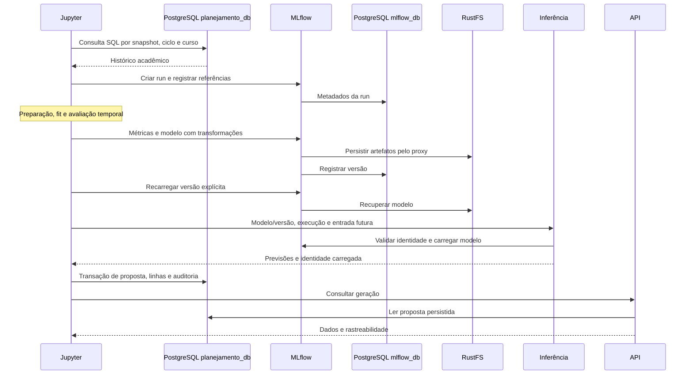

# Arquitetura da POC

O ambiente é definido em `compose.yaml` e executa onze serviços contínuos na rede
Docker Compose. Duas imagens próprias atendem aos serviços Python e ao Jupyter;
PostgreSQL, RustFS e RabbitMQ usam suas imagens específicas.

## Jornada principal: SQL até Planilha Turmas

O notebook principal usa `SOURCE_DATABASE_URL` com o papel `planning_readonly`
para extração e `APPLICATION_DATABASE_URL` com `planning_app` para persistência.
O treino e a composição executam no kernel do Jupyter. A inferência HTTP executa
no serviço `inference`, em `/internal/draft/predict`, carregando a versão indicada
pelo pedido. A resposta informa se foi carregada e se houve promoção operacional.

O MLflow 3.11.1 oferece Tracking e Registry no mesmo servidor. Antes de abrir
HTTP, executa o upgrade oficial de seu schema. O experimento da jornada usa
`mlflow-artifacts:`; uploads/downloads passam pelo proxy, com destino
`s3://pucpr-poc/mlflow`. O notebook não faz uma segunda gravação manual do modelo.

## Bancos, armazenamento e permissões

`planejamento_db` e `mlflow_db` pertencem à mesma instância PostgreSQL.

| Responsabilidade | Banco / papel |
|---|---|
| DDL acadêmico e migrations Alembic | `planejamento_db`, `planning_migration` |
| Escrita de dados e propostas | `planejamento_db.planning`, `planning_app` |
| Leitura do histórico e observação | `planejamento_db.planning`, `planning_readonly` |
| Metadados de tracking e Registry | `mlflow_db`, papel `mlflow`, schema gerenciado pelo MLflow |

O servidor MLflow usa psycopg2; a aplicação usa psycopg3. Não há migrations da
aplicação sobre as tabelas internas do MLflow. RustFS guarda modelos, artefatos,
snapshots e backups. PostgreSQL, RustFS e RabbitMQ usam volumes nomeados; workspace,
relatórios e eventos são bind mounts em diretórios do projeto.

## Entrada de dados e publicação por modelo

O fluxo complementar usa o SDK `src.workbench.sdk` para enviar
bases agregadas à API `ingestion`, acompanhar treinamento e registrar candidatos
por série acadêmica. Nesse fluxo, os módulos de treino usam HTTP/S3; isso é
independente das conexões SQL disponíveis para o notebook principal.

Aprovação auditada seleciona uma versão e ajusta o alias `champion`. O comando
`publish` gera um arquivo Compose adicional e sobe uma API dedicada por modelo
aprovado. A API de negócio e os workers passam pelo roteador `inference` para
alcançar esses servidores. A publicação executa no host; os containers não
recebem o socket Docker. Detalhes e contratos de artefatos estão no
[guia C3](../operations/C3_TRAINING.md).

## Processamento assíncrono e observabilidade

RabbitMQ transporta as tarefas Celery. O worker consulta e grava o estado durável
dos jobs no PostgreSQL. A fila não é o repositório definitivo dos resultados.
Esse processamento em lote é complementar à chamada síncrona da jornada DRAFT.

O serviço `monitoramento` consulta qualidade, execuções e deployments a cada
30 segundos, sem disparar treino ou promoção. Notebook, API e inferência emitem
eventos JSONL em `data/compose-logs`. O dashboard lê esses arquivos e permite
filtrar pelo `correlation_id` comum à execução. Logs completos dos containers
continuam acessíveis por `docker compose logs`.

## Rede e inicialização

Containers usam DNS interno, como `postgres`, `mlflow`, `rustfs` e `api`.
As interfaces do usuário são publicadas em `127.0.0.1`, com portas documentadas
no [README](../../README.md#interfaces-e-acesso). PostgreSQL fica apenas na rede interna.

Os scripts iniciam as dependências, executam bootstrap/migrations/seed e aguardam
healthchecks. A disponibilidade inclui verificações de dependências reais; o
notebook acrescenta uma run de diagnóstico com gravação/leitura de artefato.
Falhas posteriores são reportadas pelos healthchecks e pelas etapas do notebook.

[Sequência operacional](../operations/JOURNEY.md) · [Fluxo dos dados](DATA_FLOW.md).
