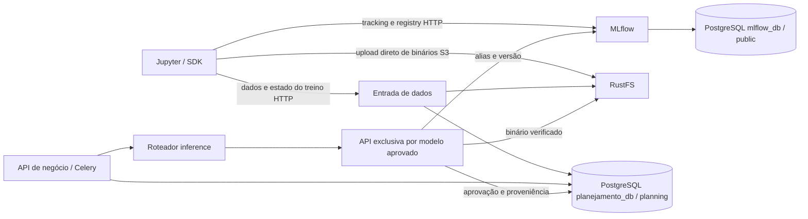

# Arquitetura atual

Onze serviços Compose, dois utilitários e uma API adicional por modelo publicado.
Jupyter representa o Workbench e não recebe credenciais PostgreSQL: usa SDK/HTTP/S3.

Volumes nomeados preservam PostgreSQL/RustFS/RabbitMQ; Jupyter monta workspace/.
Dashboard mantém dados de negócio e histórico de logs. Logs atuais via Compose.
Collector Kubernetes permanece reservado à referência Helm.
API faz previsão síncrona; batch usa RabbitMQ/Celery com estado durável no banco.
P e Q são bancos distintos da mesma instância PostgreSQL; SQLite não é usado.
Cada API dedicada carrega um binário aprovado e nunca treina durante a previsão.
Registro, aprovação e publicação são etapas separadas. Publicação ocorre pelo host/pipeline,
sem Docker socket nos containers. Monitor não dispara treinamento.
MLflow usa psycopg2; aplicação usa psycopg3.
[Operação C3](../operations/C3_TRAINING.md). [Kubernetes futuro](../../deployment/helm/README.md)
é referência histórica; ainda não inclui estes novos serviços nem uma implantação GCP validada.
