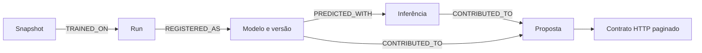

# HI-LINEAGE/1.0

Implementação central: `src/common/lineage.py`. JSON canônico usa UTF-8, chaves
ordenadas, sem espaços, sem NaN; SHA-256 dos bytes. IDs UUID gerados uma vez.

| Identidade | Significado |
|---|---|
| solution_id/environment/domain | horarios-inteligentes/poc/planilha-turmas |
| academic_cycle_id/cycle_code | UUID relacional/código do semestre |
| snapshot_id/snapshot_sha256 | Fotografia selada/hash do manifesto original |
| dataset_sha256 | Hash da extração CSV específica da jornada |
| model_key | Chave estável; séries C1-CR1-P1 preservadas |
| experiment_id/run_id | Identificadores nativos MLflow |
| registered_model_name/model_version | Versão explícita, nunca arquivo mais recente |
| artifact_sha256 | Bytes model.pkl; bundle legado usa hash bundle.json |
| inference_id | Uma invocação efetiva do serviço |
| proposal_id/execution_id | Alias compatível da geração de negócio |
| proposal_revision | 1 para o original; não é versão do modelo |
| correlation_id/trace_id | Correlação da jornada/tentativa instrumentada |
| ruleset_version/ruleset_hash | Regra e parâmetros determinísticos DEMO |
| code_version/config_hash | Hash dos fontes/configuração de treino |
| training_campaign_id | Ensaio/campanha identificado, separado da run |

Migration005 acrescenta `lineage_entities`, `lineage_edges`,
`proposal_model_usage` (N:N com atribuição por linha) e
`proposal_contract_evidence`. Não modifica tabelas MLflow. Cabeçalhos antigos
continuam válidos. Backfill conserva apenas fatos disponíveis e marca
`LEGACY_PARTIAL`; inference_id/hash/atribuição desconhecidos ficam NULL.
Não existe FK cruzando mlflow_db e planejamento_db: a validação usa SDK.

Navegue por `GET /v1/lineage?kind=proposal|run|model|snapshot&external_id=...`.
Bearer API_TOKEN é obrigatório; limit1–500/offset, resultado FOUND/NOT_FOUND.
SQL equivalente em `sql/queries/lineage_by_*.sql`. A vista
`planning.v_lineage_proposal` inclui origens legadas, mesmo sem grafo completo.

RustFS: modelos em `pucpr-poc/mlflow/` controlados exclusivamente pelo servidor;
snapshots em `snapshots/<id>/manifest.json` preservam schema1.0 e hash original.
Novos manifests HI-LINEAGE usam `lineage/poc/planilha-turmas/` e subpastas
`proposals/<id>/revisions/1/`, `inferences/<id>/`, `campaigns/<id>/`.
Escrita condicional If-None-Match impede sobrescrita; retry idêntico aceita,
conteúdo diferente rejeita. Manifest de proposta é publicado após commit SQL:
em falha de storage, repetir `publish_manifest` completa a publicação sem duplicar.

O contrato legado de bundle2.0 chama hash de snapshot de dataset_sha256.
Esse legado não é reinterpretado silenciosamente. A jornada HI-LINEAGE separa
snapshot_sha256 e dataset_sha256. Aprovação permanece em model_deployments;
tag de validação não é autorização de publicação.
