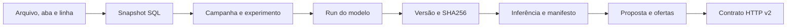

# Rastreabilidade V4

O caminho auditável é **fonte → snapshot → campanha → run → modelo/versão → inferência
→ proposta → resposta HTTP**. Identificadores diferentes cumprem funções diferentes;
`campaign_id` identifica ciência e `proposal_id` identifica uma geração de negócio.

`GET /v2/audit/proposals/{id}` verifica fontes SQL, snapshot, Registry, run,
assinatura, artefatos no proxy/RustFS e manifests das inferências. Os IDs e hashes
devem corresponder à contribuição de cada modelo nas ofertas. `VERIFIED` é o
resultado dessa conferência viva; não equivale a aprovação acadêmica.

Manifests de modelos ficam em `lineage/poc/planilha-turmas/v4/models/`; os demais
manifestos são referenciados no payload. O binário permanece sob gestão do MLflow.
JSON canônico usa UTF-8, chaves ordenadas, separadores sem espaços e nenhum NaN.
`payload_sha256` identifica uma página HTTP; `proposal_sha256`, a proposta integral;
`artifact_sha256`, os bytes do modelo. Não são hashes intercambiáveis.

Campanhas usam checkpoints `workbench_campaigns/workbench_models`; geração usa
`operation_jobs`. Os eventos e Traces conectam `campaign_id`, `job_id`, `correlation_id`
e `trace_id` quando aplicáveis. As tags são índices de busca, não a autoridade de aprovação.

Contratos V1 e grafo anterior permanecem para consultas históricas; ausência de
evidência não recebe verificação fictícia. [Dicionário V4](../contracts/HI_TAGGING_STANDARD.md)
· [Governança](../operations/REVIEW_INTEGRITY.md).
